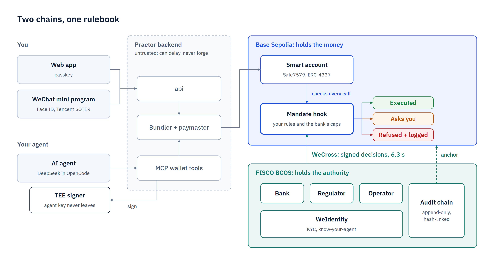
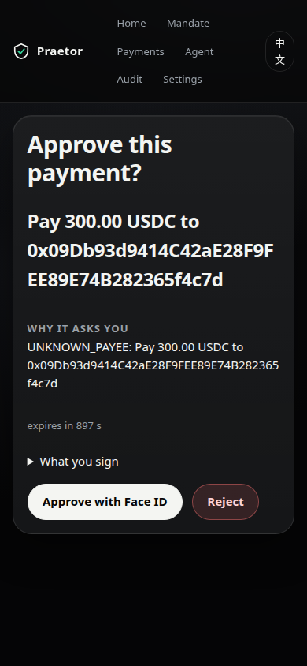
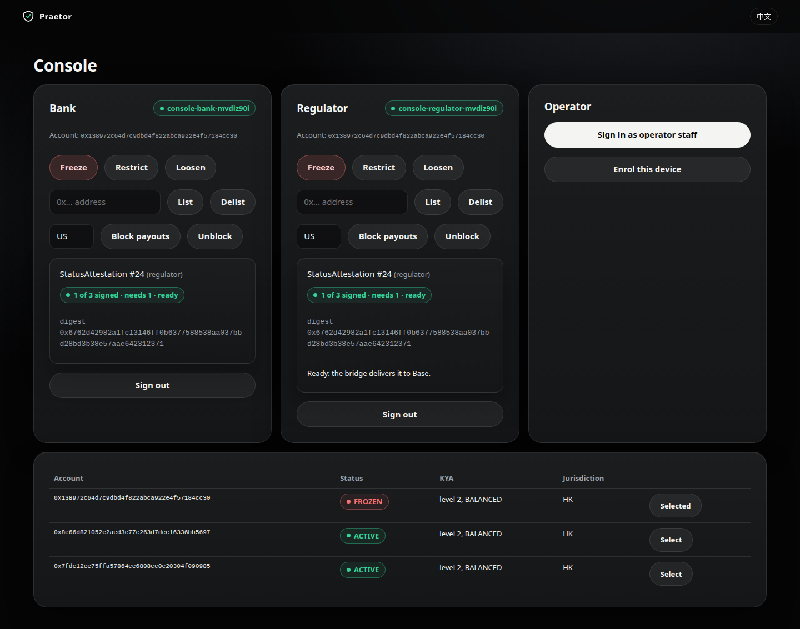
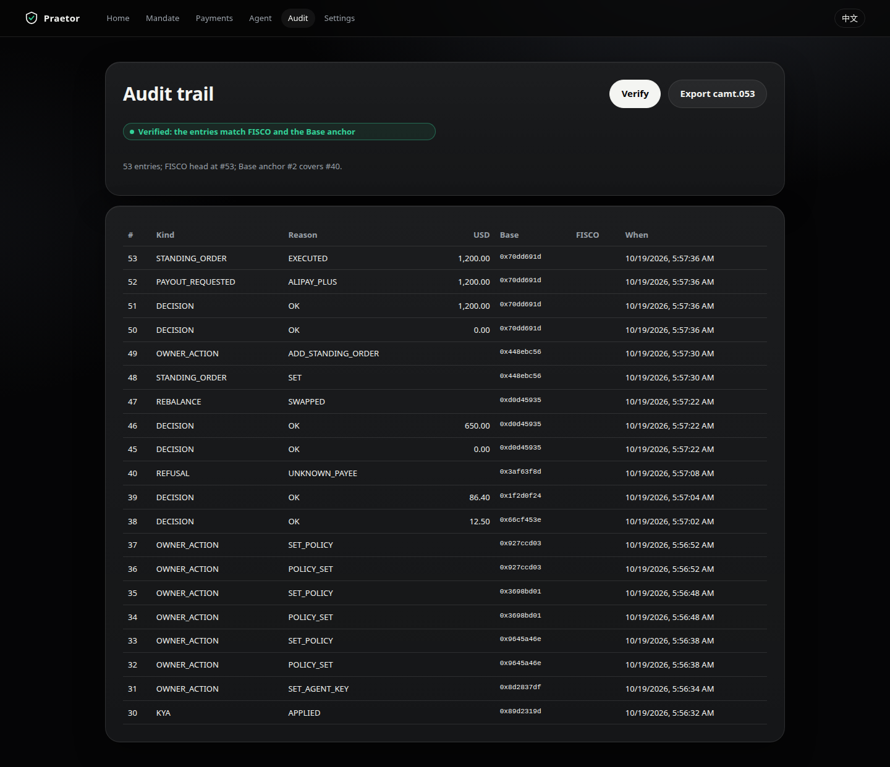

# Praetor

**受监管 AI 智能体钱包的控制平面。**

> 自动驾驶的资金，刹车握在监管者手中。（Self-driving money. The regulator holds the brakes.）

一个 AI 智能体在链上授权委托的约束下，操作 **Base Sepolia** 上的 ERC-4337 智能账户。对它的权力（身份、合规、治理、审计）掌握在**银行、监管机构和运营方**手中，三者组成 **FISCO BCOS** 联盟链，基于微众银行的开源技术栈构建：**FISCO BCOS、WeIdentity 和 WeCross**。智能体的每一个操作都在链上检查、绑定到经过验证的身份，并受联盟治理。

FinTechathon 2026（深圳，微众银行 x 清华五道口），国际赛道，赛题 F「智能体钱包」（Agent Wallet）。English: [README.md](README.md)。

| | |
|---|---|
| **在线体验** | **https://app.praetorwallet.com**（Base Sepolia，仅测试网）。任何人都可以在 `/start` 用通行密钥（passkey）开户；链上 1 USDC 代表故事中的 100，演示资金很少，可向团队申请。以下部分按设计不对访客开放：联盟控制台（已登记的员工设备）和微信（小程序测试账号的测试者）；一键沙盒只在本地分叉上运行（`make up`）。 |
| **链上证据** | [EVIDENCE-SERVER.md](docs/zh-CN/EVIDENCE-SERVER.md)（[English](docs/EVIDENCE-SERVER.md)）：公开服务器、Phala Cloud 上的两个 TEE，以及 Base Sepolia 上一次微信 Face ID 审批。[EVIDENCE.md](docs/EVIDENCE.md)：2026-10-18 的证据运行，10 个流程，21 个 BaseScan 链接，包括已执行与被拒绝的交易。 |
| **演示视频** | [VIDEO_URL] |
| **演示文稿** | [DECK_URL] |
| **文档** | [架构](docs/zh-CN/ARCHITECTURE.md)、[安全自评](docs/zh-CN/SELF_ASSESSMENT.md)、[规范](spec/README.md)（英文）、[部署](docs/zh-CN/DEPLOY.md)、[中文文档索引](docs/zh-CN/README.md) |

## 架构：两条链，一本规则

<picture>
  <source media="(prefers-color-scheme: dark)" srcset="docs/pitch/diagrams/dark/01-architecture.png">
  
</picture>

- **Base Sepolia 掌管资金。** 每个用户的 Safe7579 账户只有一个 ERC-7579 钩子 `MandateHook`，每一次执行都要经过它：执行、请所有者确认，或拒绝并记录原因。
- **FISCO BCOS 掌管权力。** 银行、监管机构和运营方在四节点的 FISCO BCOS 3.17.1 联盟链上运行成员服务：身份、合规名单、智能体状态、审计日志。
- **WeCross 传递决定。** 联盟的决定是成员在 FISCO 上签署的 EIP-712 消息；WeCross 路由把它送到 Base，WeCross 在 120 秒内未送达的消息由中继器（relayer）送达。
- **钩子重新验证每一个签名**（成员不重复、门限、nonce、截止时间）。后端、大模型、bundler、WeCross 和中继器都不受信任：它们可以延迟一个决定，却无法伪造。图中的 6.3 秒（一次冻结从 FISCO 到 Base）是在本地分叉上测得的。

## Praetor 提供什么

| 能力 | 作用 | 位置 |
|---|---|---|
| 智能体钱包 | 每个用户一个 Safe7579（ERC-4337）账户；所有者最多持有四个通行密钥；智能体密钥保存在 TEE 中（Phala Cloud，Intel TDX） | `contracts/base`、`services/agent-signer`、`services/bundler` |
| Mandate hook（授权委托钩子） | 执行所有者的规则和银行的限额，取更严格者；默认拒绝；每个操作都属于一个等级，T0 至 T4（见下） | `contracts/base/src/MandateHook.sol`、`src/hook/` |
| 身份（KYC） | 银行作为 WeIdentity 发行方，向用户的 WeID 签发 `PersonKYC` 凭证；个人数据加密保存在银行内 | `services/bank`、`services/identity` |
| 了解你的智能体（KYA） | 智能体 WeID；`AgentMandate` 由用户签署、银行联署；银行核验 TEE quote，向 Base 发送带 TEE 度量值的 KYA | `services/bank`、`MandateRegistry.sol` |
| 选择性披露 | EUDI 钱包路径（OpenID4VP、SD-JWT：只披露出生日期和国家），已用测试数据做单元测试；WeIdentity 选择性披露已构建并有集成测试，未用于演示流程 | `services/bank/src/eudiw.ts`、`test/integration/identity.test.ts` |
| 合规 | 制裁名单、出款司法辖区、获准资产与交易对手、按风险画像设定的银行限额，在 FISCO 上设定、由钩子执行；ERC-3643 的 `IdentityRegistry` 和 `Compliance` 管控代币化贵金属 | `contracts/fisco/src`、`contracts/base/src/tokens` |
| 联盟治理 | 收紧需三分之一，放宽需三分之二，限额与 KYA 由银行单独负责；nonce 在 FISCO 上分配；运营方沉默 15 分钟（生产配置），智能体即失去自主权 | `contracts/fisco/src/Board.sol`、`services/bank`、`regulator`、`operator` |
| 跨链传输 | WeCross 路由 1.4.0 加 Praetor 为 Base 编写的 EVM 插件；只持有传输密钥；bridge-relayer 作为看门狗 | `wecross/evm-stub`、`services/bridge-relayer` |
| 资产管理 | USDC、代币化黄金（tXAU）和白银（tXAG）各有区间；智能体按 Base Sepolia 上的 Pyth 价格与资金台（treasury desk）进行再平衡 | `TreasuryDesk.sol`、`PriceOracle.sol`、`services/scheduler`、`oracle-feeder` |
| 付款与审批 | 智能体在自动限额内向已知收款方付款；所有者用通行密钥或微信内的 Face ID（SOTER，由 TEE 中的证明服务核验）批准确切的那一笔调用 | `services/mcp`、`services/api`、`services/soter-attester` |
| 定期付款与出款 | 定期账单由账户的执行器保存在链上；由出款合作方通过托管出款通道，经 Alipay+ 或微信支付（模拟服务）支付 | `StandingOrders.sol`、`PayoutRail.sol`、`services/payout-partner` |
| 渠道 | Web 应用（PWA，EN 与中文）、微信小程序、联盟控制台、供外部智能体使用的 MCP（OAuth 2.1） | `apps/web`、`apps/miniprogram`、`services/mcp` |
| 审计 | FISCO 上的哈希链日志，由两个成员锚定到 Base，从三个来源校验；导出 ISO 20022 camt.053 对账单 | `services/operator`、`AuditLog.sol`、`Anchor.sol` |
| 智能体运行时 | 真实模型（经 OpenCode 调用 DeepSeek）；内置工具全部禁用；只能通过 Praetor 的十个 MCP 工具接触资金 | `services/agent-runner`、`services/mcp` |
| 密钥轮换与恢复 | 停止或轮换智能体密钥；添加设备；所有通行密钥丢失时：银行重新 KYC，之后有 48 小时延迟，期间任何仍持有的通行密钥都可以取消 | `services/api`、`services/bank`、`MandateHook.sol` |

分级授权，由钩子执行：

| 等级 | 谁 | 示例 |
|---|---|---|
| T0 永不 | 无人：钩子拒绝 | 超过银行限额、受制裁收款方、隐藏调用、冻结期间 |
| T1 自主 | 智能体独自 | 在自动限额内向已知收款方付款、在区间内再平衡、到期的定期付款指令 |
| T2 人工 | 所有者：通行密钥或 SOTER | 未知收款方、超过自动限额或预算 |
| T3 所有者 + 银行 | 所有者与银行（收紧规则时所有者独自即可） | 修改授权委托、定期付款指令、智能体密钥 |
| T4 联盟 | 收紧需三分之一，放宽需三分之二，限额与 KYA 由银行负责 | 冻结、制裁、资产、心跳 |

## 流程

每个流程都是一个 e2e 测试（`test/e2e`），在全新的本地分叉上通过 api 和 Web 应用（Playwright）运行通过。Base Sepolia 一列链接到对应交易。

| 流程 | 内容 | 在 Base Sepolia 上 |
|---|---|---|
| F1 开户 | 通行密钥、智能账户、银行 KYC、TEE 中的智能体密钥、AgentMandate、KYA | [证据运行](docs/EVIDENCE.md#f1--onboarding-passkey-account-kyc-agent-in-the-tee-agentmandate-kya-agent-key)、[服务器](docs/zh-CN/EVIDENCE-SERVER.md#微信运行2026-10-20真实-iphone) |
| F2 绑定微信 | 把微信 SOTER 密钥绑定到账户（通行密钥与银行） | [服务器](docs/zh-CN/EVIDENCE-SERVER.md#微信运行2026-10-20真实-iphone) |
| F3 授权委托 | 所有者设定规则；银行在 FISCO 上检查后联署 | [证据运行](docs/EVIDENCE.md#f3--mandate-set-with-the-passkey-after-the-banks-fisco-check-then-funded)、[服务器](docs/zh-CN/EVIDENCE-SERVER.md#微信运行2026-10-20真实-iphone) |
| F4 再平衡 | 演示价格冲击唤醒智能体，它独自卖出 tXAU，回到区间内（T1） | 仅本地分叉 |
| F5 智能体付款 | 独自向已知收款方付款（T1）；被提示词注入的、指向受制裁地址的付款在链上被拒（SANCTIONED） | [T1](docs/EVIDENCE.md#f5--the-agent-pays-a-known-payee-alone-t1-real-model)、[SANCTIONED](docs/EVIDENCE.md#f5b--prompt-injection-to-a-sanctioned-address-the-real-model-declined-the-same-payment-signed-with-the-agent-key-refused-on-chain-sanctioned) |
| F6 人工审批 | 新收款方被拒（UNKNOWN_PAYEE）；所有者批准这一笔确切的调用；只执行一次 | [通行密钥](docs/EVIDENCE.md#f6--a-new-payee-is-t2-the-owner-approves-the-exact-call-with-the-passkey-it-executes-once-1)、[微信 SOTER](docs/zh-CN/EVIDENCE-SERVER.md#微信运行2026-10-20真实-iphone) |
| F7 定期付款指令 | 房租（所有者 + 银行）经出款通道和 Alipay+ 模拟服务支付 | [证据运行](docs/EVIDENCE.md#f7--rent-standing-order-owner--bank-paid-through-the-payout-rail-alipay-mock) |
| F8 审计 | 链头由两个成员锚定到 Base，完成校验，导出 camt.053 | [证据运行](docs/EVIDENCE.md#f8--audit-the-head-anchored-on-base-by-two-members-verified-camt053) |
| F9 联盟治理 | 监管者一个签名经 WeCross 冻结，下一笔付款被拒（FROZEN），放宽需要两个签名；心跳、制裁、资产、司法辖区、限额 | [冻结与放宽](docs/EVIDENCE.md#f9--the-regulator-freezes-with-one-signature-via-wecross-an-agent-payment-is-refused-frozen-loosening-needs-two)；其余在本地分叉上 |
| F10 轮换与恢复 | 停止并轮换智能体密钥；带 48 小时延迟的所有者恢复 | 仅本地分叉（48 小时时间跳跃） |

「证据运行」指 2026-10-18 在 M16 部署上的证据运行；「服务器」指公开服务器及其 2026-10-19 的部署。二者是 Base Sepolia 上两个不同的部署。

## 安全

- **19 个不变量** I1 至 I19（[spec/01-system.md](spec/01-system.md#invariants-tests-must-prove-each-numbering-used-across-the-spec)），在[安全自评](docs/zh-CN/SELF_ASSESSMENT.md)（[English](docs/security/SELF_ASSESSMENT.md#3-invariants-and-the-tests-that-prove-them)）中逐一对应证明它的测试，并列出 34 项已知风险。
- **红队测试：100 次攻击，0 次得逞**，全部在本地分叉上运行（2026-10-19）：85 个脚本化攻击、3 个涉及共享状态的攻击、12 个使用真实模型的攻击（3 个被系统拦截，9 个被模型拒绝；它们的脚本化孪生用例表明系统同样会拦截这些攻击）。是否「得逞」依据链上状态判断，从不依据模型说了什么。留出用例尚未运行。[redteam.md](docs/security/redteam.md)
- **合约**：235 个 Foundry 单元、模糊与不变量测试，另有 13 个在真实 Safe7579 上的分叉测试；`MandateHook.sol` 行覆盖率 99.52 %。对 Praetor 自己的 Base 代码运行 Slither：High 0，Medium 27，均已说明（[slither.md](docs/security/slither.md)）。
- **Base 上没有个人数据（I19）**：`make i19-scan` 在 M16 部署上以及红队测试之后的本地分叉上均未发现个人数据。
- **TEE**：两个 CVM 运行在 Phala Cloud 上，其 compose 哈希在银行的允许列表中；两项仍未关闭（TLS 在 Phala 网关处终止，调试位交由 Phala 的验证服务判断）：[tee-checklist.md](docs/security/tee-checklist.md)。

## 运行

前置条件：Linux x86_64（在 Ubuntu 24.04 上测试），Docker（Compose v2）、Node 22 与 pnpm 10.29.1、Foundry 1.7.1，建议 16 GB 内存。Java 只在固定版本的镜像中运行。

```bash
git clone --recurse-submodules <repository> praetor && cd praetor
make setup        # commit-msg 钩子 + pnpm install --frozen-lockfile
pnpm keys         # 将所有缺失的密钥和机密写入 .env（权限 600）；只打印公开地址
make up           # Base Sepolia 的 anvil 分叉、4 个 FISCO 节点、WeIdentity、WeCross、TEE 模拟器、
                  # 成员服务、智能体、模拟服务；部署合约；构建 Web 应用
pnpm seed         # 可选：演示用户 Lin，完成开户并注资
make test         # 守卫检查、gitleaks、类型检查、全部单元测试、Foundry
make test-int     # 架构中每条链路一个集成测试（需要 make up）
make e2e          # 通过 api 和 Web 应用运行流程 F1 至 F10，最后运行 48 小时恢复（需要 make up）
```

然后打开 **https://praetor.localhost**（Caddy 内部 CA：接受浏览器警告，或信任 `caddy` 容器中的 `/data/caddy/pki/authorities/local/root.crt`）。分叉上的一键沙盒位于 `/sandbox`。更多目标：`make help`。服务器与 Phala Cloud 部署：[docs/zh-CN/DEPLOY.md](docs/zh-CN/DEPLOY.md)（[English](docs/DEPLOY.md)）。

## 状态

- **已在本地分叉上构建并测试**：上表中的全部能力（TEE 运行在 dstack 模拟器上），里程碑 M0 至 M18（[PROGRESS.md](docs/PROGRESS.md)）。
- **Base Sepolia 实链运行（2026-10-18）**：证据运行使用 Pyth 的真实价格、真实模型，并以 WeCross 为传输（[EVIDENCE.md](docs/EVIDENCE.md)）。
- **公开服务器（2026-10-20）**：https://app.praetorwallet.com，部署在香港的 Google Cloud 上，有自己的 Base 部署（MandateHook `0x6411cc907Ace53F1Bdf8607a85991d3b38E79a5f`）和自己的 FISCO 联盟。
- **Phala Cloud 上的 TEE**：agent-signer 与 soter-attester 运行在 Intel TDX CVM 中；银行核验了证明服务的 quote 并在 Base 上激活它。dstack 模拟器只用于本地运行。
- **iPhone 上的微信**：在服务器上，一笔被拒的付款经 Face ID（SOTER）批准并只执行一次；在本地分叉上，另有重放被拒、冻结、解绑、中文界面。
- **生产演练**（在分叉上）：以 `compose.prod.yml` 运行 `make rehearsal`，冒烟测试 16/16，五项生产拒绝检查均通过。
- **国密（SM）配置**：冒烟测试记录在 [SMOKE.md](docs/SMOKE.md)。
- **标注为模拟的服务**：KYC 供应商、出款合作方、Alipay+ 与微信支付；沙盒是临时替代方案。
- **后续工作**：微信公众号消息、用真实钱包扫码的 EUDI 流程、演示视频、Android 指纹、手机上的 Web 推送、渗透测试、红队留出用例。

| 文档 | 内容 |
|---|---|
| [ARCHITECTURE.md](docs/zh-CN/ARCHITECTURE.md)（[English](docs/ARCHITECTURE.md)） | 系统、核心算法、安全设计、部署 |
| [SELF_ASSESSMENT.md](docs/zh-CN/SELF_ASSESSMENT.md)（[English](docs/security/SELF_ASSESSMENT.md)）、[security/](docs/security/README.md) | 分级授权、不变量及其测试、威胁模型、已知风险、工具结果 |
| [EVIDENCE-SERVER.md](docs/zh-CN/EVIDENCE-SERVER.md)（[English](docs/EVIDENCE-SERVER.md)）、[EVIDENCE.md](docs/EVIDENCE.md) | Base Sepolia 上的交易，包括已执行与被拒绝的 |
| [DEPLOY.md](docs/zh-CN/DEPLOY.md)（[English](docs/DEPLOY.md)）、[MANUAL.md](docs/MANUAL.md)、[TESTER.md](docs/TESTER.md) | 部署、引导式验收步骤、真机测试 |
| [spec/](spec/README.md)、[DECISIONS.md](docs/DECISIONS.md)、[PREEXISTING.md](docs/PREEXISTING.md) | 构建规范、规范之后的决策、复用的代码 |
| English | [README.md](README.md) |

## 界面

| 所有者批准确切的调用 | 监管者一个签名即可冻结 | 审计链，已校验 |
|---|---|---|
|  |  |  |

## 团队与许可

Alexandre Huou（EPFL），Stan Stelcher（HEIG-VD）。

Copyright © 2026 the Praetor team. All rights reserved. Source made available for evaluation by FinTechathon 2026 organisers and judges（[LICENSE](LICENSE)）。版权所有 © 2026 Praetor 团队，保留所有权利；源代码仅供 FinTechathon 2026 组织方和评委评审使用。第三方组件保留各自的许可：[NOTICE](NOTICE)、[THIRD_PARTY_LICENSES.md](THIRD_PARTY_LICENSES.md)。
