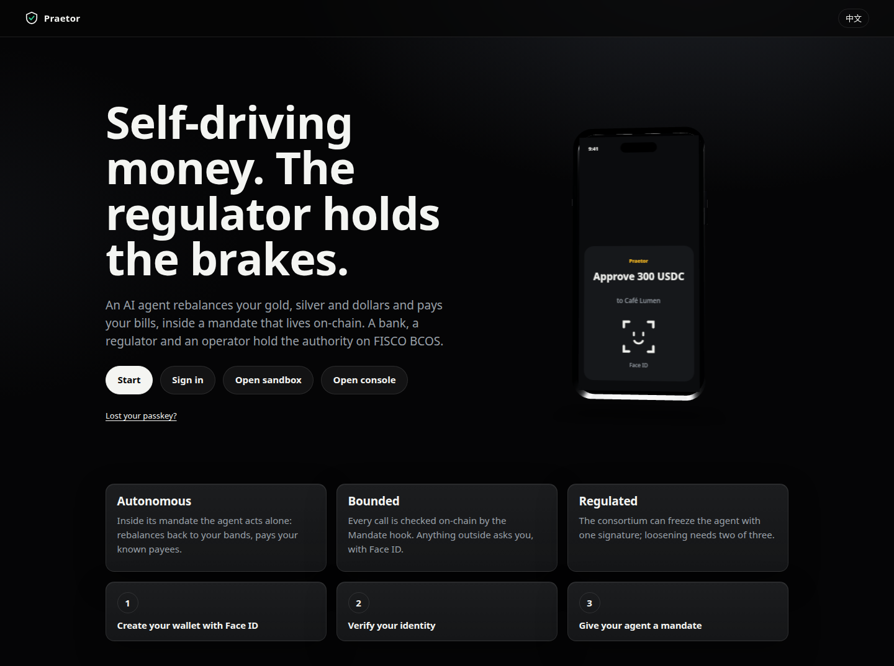

# Praetor

> **自动驾驶的资金，刹车握在监管者手中。**（Self-driving money; the regulator holds the brakes.）

FinTechathon 2026（深圳，微众银行 x 清华五道口），国际赛道，赛题 F「智能体钱包」（Agent Wallet）。English: [README.md](README.md)。

一个 AI 智能体管理您的投资组合（USDC、代币化黄金和白银），并从 **Base Sepolia** 上的 ERC-4337 智能账户自主支付账单。账户发出的每一笔调用都要经过链上的 **Mandate hook（授权委托钩子）**：它执行您的规则和银行的限额，默认拒绝；任何异常操作都需要您用 Face ID 确认（通行密钥 passkey，或微信内的 SOTER）。由银行、监管机构和运营方组成的 **FISCO BCOS** 联盟链掌握权力：身份（WeIdentity）、获准资产、制裁名单、智能体状态，以及只能追加的审计日志。联盟的决定以成员签名的形式到达 Base，由钩子自行验证，经 **WeCross** 传输，并由一个中继器（relayer）作为看门狗。智能体的密钥保存在 **TEE** 中（Phala dstack，Intel TDX）。监管者一个签名即可在合约层面冻结智能体（监管冻结）；放宽则需要三分之二成员签名。



## 五句话看懂演示

1. **用 Face ID 开户**：通行密钥创建智能账户，在银行完成演示 KYC，智能体密钥在 TEE 中派生并经银行核验，授权委托由您签署、银行联签。
2. **金价上涨 20 %**（演示价格）：智能体被唤醒，独自卖出约 650 美元的 tXAU，回到区间内（T1）。
3. **「向 Café Lumen 支付 300」**：被链上拒绝（未知收款方），您用通行密钥批准（或在微信中用 Face ID，M14），随后完成支付（T2）。
4. **一次提示词注入**要求智能体向受制裁地址付款：被拒绝，`RefusalLog` 记录钩子计算出的原因（SANCTIONED）。
5. **监管者在控制台用一个签名冻结智能体**：FISCO、WeCross、Base；下一笔操作被拒绝，原因为 FROZEN；解冻需要两个成员。随后审计链对照 FISCO 及其 Base 锚点完成校验，并导出为 ISO 20022 camt.053 对账单。

## 分级授权：边界如何设定

| 等级 | 谁 | 示例 |
|---|---|---|
| T0 永不 | 无人：钩子拒绝 | 超过银行限额、受制裁收款方、隐藏调用、冻结期间 |
| T1 自主 | 智能体独自 | 在自动限额内向已知收款方付款、在区间内再平衡、到期的定期付款指令 |
| T2 人工 | 所有者：通行密钥或 SOTER | 未知收款方、超过自动限额或预算 |
| T3 所有者 + 银行 | 所有者与银行（收紧规则时所有者独自即可） | 修改授权委托、定期付款指令、智能体密钥 |
| T4 联盟 | 收紧需三分之一，放宽需三分之二，限额与 KYA 由银行负责 | 冻结、制裁、资产、心跳 |

图示与算法请阅读[架构文档](docs/zh-CN/ARCHITECTURE.md)（[English](docs/ARCHITECTURE.md)），不变量及证明它们的测试请阅读[安全自评](docs/zh-CN/SELF_ASSESSMENT.md)（[English](docs/security/SELF_ASSESSMENT.md)）。

## 快速开始（本地环境）

前置条件：Linux x86_64（在 Ubuntu 24.04 上测试），安装 Docker（Compose v2）、Node 22 与 pnpm 10.29.1、Foundry 1.7.1，建议 16 GB 内存（与生产服务器规格相同）。Java 只在固定版本的镜像中运行。

```bash
git clone --recurse-submodules <repository> praetor && cd praetor   # 或：git submodule update --init --recursive
make setup        # commit-msg 钩子 + pnpm install --frozen-lockfile
pnpm keys         # 将所有缺失的密钥和机密写入 .env（权限 600）；只打印公开地址
make up           # 完整环境：Base Sepolia 的 anvil 分叉、4 个 FISCO 节点、WeIdentity、WeCross、TEE 模拟器、
                  # 成员服务、智能体、模拟服务；在新分叉上部署合约；构建 Web 应用
make test         # 守卫检查（长破折号、链接、署名）、gitleaks、类型检查、全部单元测试、Foundry（需要 Docker）
make test-int     # 集成测试，架构中每条链路一个（需要 make up）
make e2e          # 通过 api 和 Web 应用（Playwright）运行流程 F1 至 F10，最后运行 48 小时恢复（需要 make up）
pnpm seed         # 可选：演示用户 Lin，完成开户并注资
```

然后打开 **https://praetor.localhost**。证书来自 Caddy 的内部 CA：接受浏览器警告，或信任 `caddy` 容器中 `/data/caddy/pki/authorities/local/root.crt` 的根证书。更多目标：`make help`（`make test-contracts-full` 运行 10,000 次模糊测试，`make test-fork` 运行 Safe7579 分叉测试，`make slither`、`make deploy-contracts`、`make deploy-fisco`）。

## 仓库结构

```
contracts/base      Base Sepolia 合约（Foundry）：MandateHook 及其库、验证器、NoOwner、
                    StandingOrders、PayoutRail、PriceOracle、TreasuryDesk、RefusalLog、Anchor、paymaster、代币
contracts/fisco     FISCO BCOS 合约：成员注册表、联盟提案板、审计日志、Base 发件箱
contracts/lib       固定版本的 Solidity 库（git 子模块）
packages/           protocol（EIP-712 类型、拒绝原因码、TS 与 Solidity 的黄金向量）、chain、userop、
                    config、db、fisco-client、member-kit、weid-client
services/           api、mcp、agent-runner、scheduler、bundler、oracle-feeder、notifier、bridge-relayer、
                    bank、regulator、operator、agent-signer 与 soter-attester（TEE）、identity（WeIdentity）、
                    payout-partner 及标注为模拟的服务（Alipay+、WeChat Pay、KYC 供应商）、fake-llm（测试用）
wecross/evm-stub    Praetor 为 Base 编写的 WeCross 插件（Java 8）
apps/web            Web 应用：带 3D 手机的首页、开户、仪表盘、审批、控制台、沙盒（EN、中文）
apps/miniprogram    微信小程序：首页、对话、SOTER 审批、微信绑定（EN、中文）
infra/              compose.yml、compose.prod.yml、live.env、Caddyfile、FISCO、WeIdentity、WeCross 与 TEE 模拟器
                    镜像、部署记录
test/               集成测试（每条链路一个文件）、e2e（流程 F1 至 F10）、warp（48 小时恢复）、基础设施检查
scripts/            密钥、演示（seed、价格冲击）、部署（合约、实链充值、生产拒绝检查）、证据（实链运行）、
                    检查（长破折号、链接、gitleaks、slither）
spec/               构建规范（从 spec/README.md 开始）
docs/               架构、安全材料、部署、进度、决策、手册、证据
spikes/             第 0 阶段的验证实验
```

## 文档

| 文档 | 内容 |
|---|---|
| [docs/zh-CN/ARCHITECTURE.md](docs/zh-CN/ARCHITECTURE.md)（[English](docs/ARCHITECTURE.md)） | 一张图看懂系统、核心算法、安全设计、部署 |
| [docs/zh-CN/SELF_ASSESSMENT.md](docs/zh-CN/SELF_ASSESSMENT.md)（[English](docs/security/SELF_ASSESSMENT.md)） | 分级授权、不变量 I1 至 I19 及其测试、威胁模型、已知风险、工具结果 |
| [docs/security/README.md](docs/security/README.md) | 安全材料：Slither、依赖审计、TEE 检查清单、WeCross 说明、gas |
| [docs/zh-CN/DEPLOY.md](docs/zh-CN/DEPLOY.md)（[English](docs/DEPLOY.md)） | 部署到服务器和 Phala Cloud（C 阶段） |
| [spec/README.md](spec/README.md) | 构建所遵循的规范 |
| [docs/PROGRESS.md](docs/PROGRESS.md)、[docs/DECISIONS.md](docs/DECISIONS.md) | 构建进度；规范之后所做的决策 |
| [docs/MANUAL.md](docs/MANUAL.md) | 需要人工参与的引导式验收步骤（手机、微信、云） |
| [docs/TESTER.md](docs/TESTER.md) | 供在真机上测试的队友使用：自己的环境、微信测试账号、隧道、需要报告的内容 |
| [docs/EVIDENCE.md](docs/EVIDENCE.md) | 2026-10-18 在 Base Sepolia 上实链运行（D96）的交易哈希，包括已执行与被拒绝的，以及每个流程的 FISCO 调用 |
| [docs/PREEXISTING.md](docs/PREEXISTING.md) | 复用自团队早期项目的代码 |
| 中文 | [README.zh-CN.md](README.zh-CN.md)、[docs/zh-CN/](docs/zh-CN/README.md) |

## 状态

已在本地分叉上构建并测试：Base 与 FISCO 合约、协议、bundler 与 paymaster、联盟成员服务、WeIdentity 身份与 KYC、dstack 模拟器上的两个 TEE、智能体及其 MCP 服务器、api、定期付款与出款、带锚定和 camt.053 的审计链、WeCross 传输、网页应用（含联盟控制台与临时评委沙盒，D48）、微信小程序（逻辑与 api；真机测试见下文）、智能体密钥轮换与所有者恢复（F10）、国密配置冒烟测试、生产 compose 覆盖文件及其拒绝检查。流程 F1 至 F10 通过 api 和通过网页应用（Playwright，虚拟认证器）在全新分叉上运行通过：M12（以 WeCross 为传输，2026-10-17）、M13（网页旅程、沙盒以及 34 张带 axe 检查的截图）和 M15（F10 与 48 小时恢复）的里程碑关卡均已通过，后两者于 2026-10-18 通过。合约已部署到 Base Sepolia（MandateHook `0x839E104c8C2df983213a89CAcB58440Da4AdC2A9`），预言机在那里每 5 分钟从 Pyth Hermes 获取一次真实的 XAU 与 XAG 价格（分叉仍使用预置的演示价格，D89）。红队测试（spec 08）已于 2026-10-18 针对本地栈运行：85 个脚本化攻击、3 个涉及共享状态的攻击和 12 个使用真实模型的攻击，0 个得逞（[docs/security/redteam.md](docs/security/redteam.md)）；早先运行中的发现均未转移任何价值，已全部修复并重新测试（D86 至 D88）。部署演练已通过（M18，D90）：在分叉上以 `compose.prod.yml` 运行 `make rehearsal`，冒烟测试 F1、F5、F8 16/16，五项生产拒绝检查均通过。2026-10-18 团队在 iPhone 上通过了微信相关步骤（绑定、SOTER Face ID 审批、重放被拒、监管冻结、解绑、中文界面；[docs/MANUAL.md](docs/MANUAL.md) 第 5 节）。M16 已于 2026-10-18 随实链证据运行关闭（D96）：在 Base Sepolia 上运行，使用来自 Pyth 的真实价格（周五收盘时 tXAU 4,165.33 USD、tXAG 56.99 USD）、真实模型（经 OpenCode 调用 DeepSeek），以 WeCross 为传输，`DEMO_SCALE` 为 100，并在人工给定的预算之内（D74）。根据链上数据生成的 [docs/EVIDENCE.md](docs/EVIDENCE.md) 列出 10 个流程（C0 至 F8，F6 出现两次）、21 个指向 Base 交易的 BaseScan 链接以及 FISCO 调用：一笔智能体自主完成的 T1 付款；一次指向受制裁地址的提示注入在链上被拒（SANCTIONED）；一个新收款方先被拒绝（UNKNOWN_PAYEE），再经所有者的 passkey 批准并只执行一次；房租定期付款经出款通道支付（Alipay+ 模拟服务）；监管冻结经由 WeCross 送达，智能体的一笔付款被拒（FROZEN），随后由两个成员放宽；以及 Base 上的审计锚定。F6 第一次运行失败（智能体使用的是旧指令，issue #4），在 D93 之后于同一账户上重新运行；两次尝试都记录在证据中。队友在真机测试中提出的 issue #1 至 #11 均已修复并合并（D88、D91、D93 至 D95）。后续将在 Phase C 中与人工一起完成：云端部署（服务器、域名、真实证书）、Phala Cloud 上的 TEE（证明目前仍来自 dstack 模拟器）、微信公众号、EUDI 钱包扫码、演示视频、Android 指纹、手机上的 Web 推送、红队留出用例，以及针对 Base 数据的 I19 扫描（尚未构建）。详见 [docs/PROGRESS.md](docs/PROGRESS.md)。

## 许可

Copyright © 2026 the Praetor team. All rights reserved. Source made available for evaluation by FinTechathon 2026 organisers and judges（[LICENSE](LICENSE)）。版权所有 © 2026 Praetor 团队，保留所有权利；源代码仅供 FinTechathon 2026 组织方和评委评审使用。第三方组件保留各自的许可：[NOTICE](NOTICE)、[THIRD_PARTY_LICENSES.md](THIRD_PARTY_LICENSES.md)。
