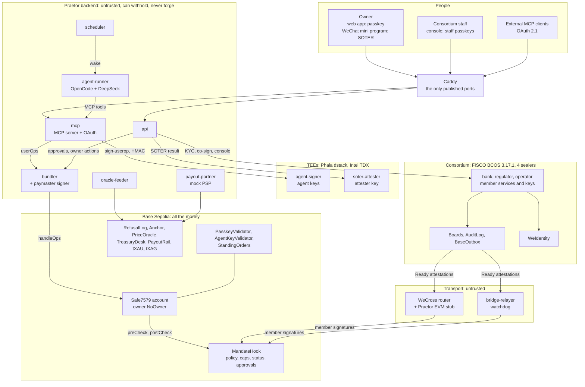
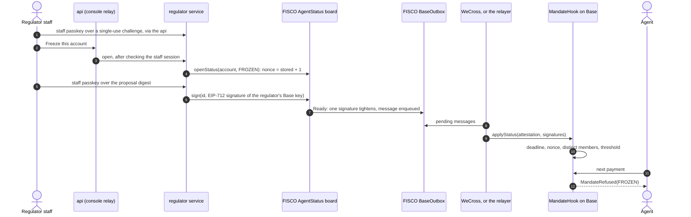
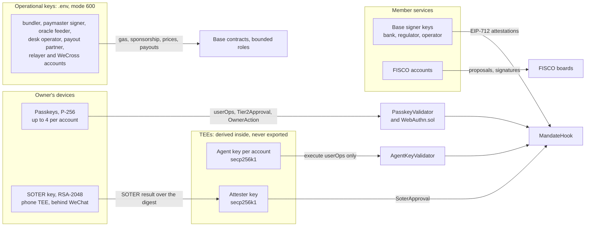
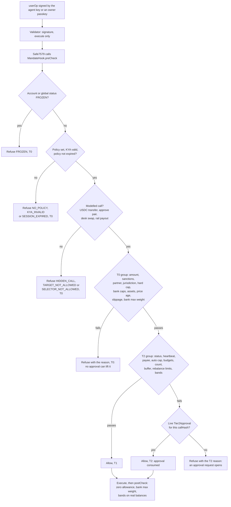
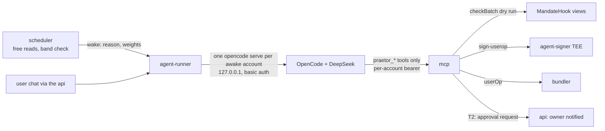

# Praetor architecture

> **Self-driving money; the regulator holds the brakes.**

Praetor is an agent wallet (FinTechathon 2026, International Track, Topic F). An AI agent manages a user's portfolio (USDC, tokenized gold tXAU, tokenized silver tXAG) and pays their bills on its own, from an ERC-4337 smart account on **Base Sepolia**. Three properties hold at once:

- **Autonomous**: inside its mandate the agent rebalances and pays without asking anyone.
- **Bounded**: every call the account makes passes an on-chain **Mandate hook** that applies the user's rules and the bank's caps, default deny. Anything unusual needs the owner's Face ID (a passkey, or SOTER inside WeChat).
- **Regulated**: a **FISCO BCOS** consortium (bank, regulator, operator) holds identity, approved assets, sanctions, the agent's status and an append-only audit log. Its decisions reach Base as member signatures that the hook verifies itself. One regulator signature freezes the agent; loosening needs two of three.

This document is the technical documentation for judges: the picture first, then the core algorithms, the security design and the deployment. It describes the code as built at the end of milestone M17; where the build differs from `spec/`, the entry in [DECISIONS.md](DECISIONS.md) is cited. Chinese version: `docs/zh-CN/ARCHITECTURE.md`. Security evidence: [security/SELF_ASSESSMENT.md](security/SELF_ASSESSMENT.md).

## 1. The system in one picture



**Trust boundaries.** Trusted for safety: the hook's code, member keys within their thresholds, the owner's passkey, the TEE measurements the bank registered, Tencent's `verify_signature` answer, WebAuthn.sol with the P-256 precompile. Everything else (api, mcp, the LLM, scheduler, bundler, relayer, WeCross, oracle feeder within its bound) is untrusted: it can delay or withhold, it cannot forge a signature the hook accepts. Silence fails safe: without heartbeats the agent loses its autonomy.

| Zone | Components (directory) |
|---|---|
| Base Sepolia (chain id 84532) | `contracts/base`: MandateHook with its libraries, PasskeyValidator, AgentKeyValidator, NoOwner, StandingOrders, PayoutRail, PriceOracle, TreasuryDesk, RefusalLog, Anchor, PraetorPaymaster, WeCrossInbox, the vendored WeCrossProxy, tXAU and tXAG (own ERC-3643 with IdentityRegistry and Compliance) |
| FISCO BCOS (chain id 20200) | `contracts/fisco`: MemberRegistry, AgentStatus, MandateRegistry, AssetRegistry, SanctionsList, JurisdictionRules, AttesterRegistry, AuditLog, BaseOutbox; WeIdentity contracts; WeCross hub and proxy |
| Member services | `services/bank`, `services/regulator`, `services/operator` on `packages/member-kit` |
| Backend | `services/api`, `mcp`, `agent-runner`, `scheduler`, `bundler`, `oracle-feeder`, `notifier`, `bridge-relayer`, `payout-partner`, `alipayplus-mock` (also the WeChat Pay mock), `kyc-vendor-mock`, `fake-llm` (tests only) |
| TEEs | `services/agent-signer`, `services/soter-attester` (dstack simulator locally, Phala Cloud CVMs in production) |
| Transport | `wecross/evm-stub` (Java 8), `infra/wecross`, `services/bridge-relayer` |
| Front ends | `apps/web` (React, the 3D phone, EN and 中文, PWA, consortium console); the WeChat mini program is built in M14 |
| Shared | `packages/protocol` (EIP-712 types, reason codes, callHash, policy, audit chain, golden vectors in TS and Solidity), `chain`, `userop`, `config`, `db`, `fisco-client`, `weid-client` |

## 2. Two chains and the bridge

Money lives on Base; authority lives on FISCO. A consortium decision is a FISCO proposal that members sign with their Base signer keys; once it reaches its threshold it is queued for Base, where the hook checks every signature again. The transport cannot change the message, only delay it. The freeze of the demo, end to end:



The e2e test `test/e2e/F9-governance.test.ts` proves this flow (freeze applied on Base within 60 s, the next agent action refused FROZEN, loosening refused with one signature and accepted with two) and `test/integration/wecross.test.ts` proves the WeCross path.

## 3. Who holds which key



| Key | Can | Cannot |
|---|---|---|
| Owner passkey | Validate owner userOps (`execute`, and the launchpad's `setupSafe` for the first op); sign Tier2Approval and OwnerAction digests | Loosen anything without the bank (T3); produce an ERC-1271 signature |
| Agent key (agent-signer TEE, `getKey("praetor/agent/<account>/v<n>")`) | Validate `execute` userOps of its account, to targets other than the account | Change rules, keys or modules; act outside the hook; sign for another chain or entry point (refused by agent-signer) |
| Attester key (soter-attester TEE) | Sign `SoterApproval` after Tencent verified a SOTER signature over the exact digest | Approve without a fresh SOTER signature; act once any one member deactivates it |
| Member Base signer keys | Sign consortium attestations | Exceed their threshold: 1 tightens, 2 loosen, the bank alone for caps, KYA, asset and attester activation |
| Member FISCO keys | Open and sign FISCO proposals, append audit entries (operator) | Anything on Base |
| Bundler, paymaster signer | Submit userOps and plain transactions to five allowlisted contracts; sponsor registered accounts | Forge a user or member signature |
| Oracle feeder | Push prices, at most 25 % per update | Trade |
| Desk operator, token agent (bank) | Register identities, operate the desk, freeze tokens; the ERC-3643 agent role can force-transfer tXAU and tXAG (known risk 12) | Move USDC; trade for others |
| Payout partner | Withdraw, settle or fail its own payouts on PayoutRail | Pull from wallets |

All non-TEE keys live in `.env` (git-ignored, mode 600) in three sets: `LOCAL_*` (anvil fork), `LIVE_*` (Base Sepolia), `SANDBOX_*` (judges' sandbox). Services read the unprefixed name first, then the active set's prefix (D1). The EIP-712 domain name carries the environment (`Praetor`, `Praetor-local`, `Praetor-sandbox`), and each environment has its own member keys, so a signature can never be replayed across environments even though the fork and live Base share chain id 84532.

## 4. Core algorithms

### 4.1 The MandateHook decision pipeline

`MandateHook` is the single global ERC-7579 hook of every account (Safe7579 supports exactly one). Safe7579 calls `preCheck` before and `postCheck` after every `execute`, `executeFromExecutor`, `installModule` and `uninstallModule`. The Safe's only native owner is `NoOwner`, whose ERC-1271 always fails, so `execTransaction` and the owner-signature fallbacks are dead ends (I1). Both validators return "invalid" to every ERC-1271 request, so USDC's `permit` and `transferWithAuthorization` cannot be used to pull funds around the hook (I16).

`preCheck` routes by selector: `execute` (single or batch mode only, canonical ABI encoding only), `executeFromExecutor` (only from StandingOrders), and module calls (only as the inner call of an approved module change, handed over in transient storage, D8). Everything else is `HIDDEN_CALL`. Each call of the execution then goes through one evaluator, `DecisionLib.evaluate`, which is also behind the views `check()` and `checkBatch()`. It never reverts on any input (I12): it returns a reason and a tier.



The checks, in the order the code applies them (spec 03, ported from BSA Sentry's `decide.rs`):

| Step | Payment (`USDC.transfer`) and payout (`PayoutRail.pay` on Alipay+ or WeChat Pay) | Rebalance (`TreasuryDesk.swap`) | Tier |
|---|---|---|---|
| Base | FROZEN, NO_POLICY, KYA_INVALID, SESSION_EXPIRED; ETH value or a call to the account itself is HIDDEN_CALL | same | T0 |
| Classify | exact selector and calldata length, canonical address padding; anything else on a known contract is SELECTOR_NOT_ALLOWED, any other target TARGET_NOT_ALLOWED | same | T0 |
| T0 group | INVALID_AMOUNT (0 or above 2^128); SANCTIONED; payout partner not ACTIVE (COUNTERPARTY_NOT_APPROVED); JURISDICTION_BLOCKED; OVER_HARD_CAP above min(policy hard cap, bank per-transaction cap); BUDGET_EXCEEDED above the bank's daily or monthly cap | INVALID_AMOUNT; desk not ACTIVE; ASSET_NOT_APPROVED (one side USDC, bought token ACTIVE, sold token not DELISTED, both in the bands); STALE_PRICE; SLIPPAGE (`minOut` below oracle value minus `maxSlippageBps`); BAND_BREACH above the bank's max weight | T0 |
| T2 group | RESTRICTED (status, owner pause or pending recovery); STALE_STATUS (heartbeat expired); UNKNOWN_PAYEE (payee or `merchantKey` not in the policy); OVER_AUTO_CAP; BUDGET_EXCEEDED (user budgets); COUNT_EXCEEDED; BUFFER_BREACH | RESTRICTED; STALE_STATUS; REBALANCE_LIMIT (`maxTradeUsd`, `maxRebalancesPerDay`); BAND_BREACH (an asset ends outside its band without moving closer to target, I15); BUFFER_BREACH | T2 |
| Approve pattern | `approve(spender, amount)` is allowed only directly before the `swap` or `pay` that spends exactly that amount, and inherits its decision; `postCheck` requires the allowance back at zero | same | inherited |
| Effects | spend counters (day = `timestamp / 1 days`, month = `timestamp / 30 days`), count, approval consumed, one `Decision` event per call | rebalance counter, `Decision` event | |

Running totals carry across the calls of a batch, so a batch cannot split a payment under a cap. A standing order executed by the StandingOrders executor applies the base and T0 checks and the approve pattern, but not the T2 group: the owner and the bank pre-approved that exact order. After execution `postCheck` reads real balances: the bought token must stay within the bank's max weight, and unless a human approved a band breach every band must end inside its range or closer to its target.

Refusals leave evidence. Safe7579 turns a hook revert into `ExecutionFailed()`, so the bundler submits refused ops anyway (rate-limited) and then calls `RefusalLog.log`, which recomputes the reason with `check()` instead of trusting the reporter (I11). The 28 reason codes of spec 02 are the wire values; the hook never returns `TIER2_REQUIRED` or `TIER2_INVALID`: an invalid approval makes its registration revert instead (D65).

### 4.2 Signatures: EIP-712 digests and passkeys

`packages/protocol` defines 13 EIP-712 types once, in TypeScript and in Solidity (`sol/PraetorTypes.sol`), and both sides are checked against the same golden vectors (`packages/protocol/vectors`). The domain is `{name, version "1", chainId 84532, verifyingContract = MandateHook}`. The chain id is the constant 84532 even on FISCO, so a FISCO board's `digestOf` is byte-identical to the digest the hook verifies (non-SM profile).

- **callHash** binds a human approval to one exact call: `keccak256(abi.encode(account, 84532, target, value, keccak256(data)))`.
- **Replay**: consortium attestations use `nonce == stored + 1` per key, allocated by FISCO (I18); Tier2Approval and OwnerAction carry a random nonce and the hook marks each digest used (`usedDigest`); expiry at most one hour; approvals are stored per account epoch, which recovery increments.
- **Passkeys**: `PasskeyValidator` keeps up to four P-256 keys per account, keyed by `credIdHash`, and verifies WebAuthn assertions with Coinbase's WebAuthn.sol (user verification required, high-s refused) on the RIP-7212 precompile at `0x100` (forge tests fall back to FreshCryptoLib). For a userOp the challenge is the userOpHash; for an approval or owner action it is the EIP-712 digest. The same check (`OwnerLib._ownerAuth`) runs inside the hook, so the owner's consent is verified on-chain, not by our servers.
- **Owner auth encoding**: `OwnerAuth{kind, data}` with `kind` PASSKEY (credential hash and WebAuthn data) or SOTER (`SoterApproval` and the attester's signature).

### 4.3 SOTER approvals through the attester TEE

SOTER is WeChat's biometric signature: the phone's TEE signs a JSON (`resultJSON`) that contains our challenge, and only Tencent can verify it (the public key is not exposed). Praetor turns it into an on-chain approval:

1. The mini program runs SOTER with the challenge set to the EIP-712 digest in hex, and sends the result with a fresh `wx.login` code.
2. The api forwards it to **soter-attester** (per-caller HMAC, D32). The attester exchanges the code for the openid, asks Tencent's `verify_signature` (must answer `is_ok`), and refuses unless `resultJSON.raw` equals the digest exactly.
3. It computes `bindingHash = keccak256(abi.encode(keccak(appId), keccak(openid), keccak(uid), keccak(cpu_id)))` (raw identifiers never reach a chain) and signs `SoterApproval{account, digest, bindingHash, soterCounter, expiresAt}` with its TEE key.
4. The hook accepts it only if the signer is an **active** attester (registered by the bank with the measurement of a verified quote, D33), account and digest match, the binding equals the account's linked binding, the expiry is within one hour, and the counter is above the stored one (`soterCounterStrict`, known risk 16).

The binding is set by `LINK_WECHAT`, an owner action that needs the passkey and the bank and carries a SOTER proof over the link digest (flow F2). SOTER is accepted only when the policy enables it, and never for `LINK_WECHAT` or `SET_OWNER_KEY`.

### 4.4 Consortium attestations: thresholds and nonces

On FISCO each decision type has a **board** contract (`contracts/fisco/src/Board.sol`): a member's FISCO account opens a proposal; the board allocates the proposal id and `nonce = stored + 1` for that key (one open proposal per key); members sign the EIP-712 digest with their Base signer keys; signatures are kept sorted by signer; at the threshold the board emits `Ready` and enqueues the attestation in `BaseOutbox`. An expired proposal is closed and releases its nonce; a Ready message that missed its Base deadline undelivered is reissued with the same nonce (D25). Member services sign only with a staff passkey assertion over the exact digest, except four automated, rule-checked signatures: the operator's heartbeat, the bank's KYA, the bank's owner-action co-signature and the bank's anchor co-signature (D24, D41).

On Base, `ConsortiumLib` (a library of the hook) accepts a message only if `block.timestamp <= deadline`, `nonce == stored + 1`, and the signatures recover to distinct members in ascending order (no duplicates, no malleable signatures). Thresholds as built:

| Message | Tighten | Loosen |
|---|---|---|
| Status (per account, or global with account 0) | 1 member, when the new status is stricter | 2 members (also for the same status) |
| Sanctions | 1 lists | 2 delist |
| Jurisdiction (stablecoin payouts blocked) | 1 blocks | 2 unblock |
| Asset (token, desk, payout partner) | any 1 suspends or delists | the bank (activation, higher max weight, kind change) |
| Attester | any 1 deactivates | the bank activates |
| Caps per risk profile, KYA | the bank | the bank |
| Heartbeat | any 1, epoch = stored + 1, valid at most one day | |
| Anchor (`Anchor.anchor`) | any 2 members, seq = stored + 1 | |

The effective status of an account is the stricter of its own status and the global one. A freeze also blocks module changes, including removing the hook (D19).

### 4.5 Heartbeat fail-safe

The operator service opens a `HeartbeatAttestation` every `HEARTBEAT_INTERVAL_S` (60 s locally, 300 s in production) valid for `HEARTBEAT_TTL_S` (180 s locally, 900 s in production) after the latest Base block time, and signs it itself. If the heartbeat lapses (the consortium is down, the transport is cut, or someone withholds messages), every autonomous action is refused `STALE_STATUS`. It is a T2 reason: the owner can still approve a payment by hand, and the agent regains its autonomy at the next heartbeat. Withholding therefore never extends the agent's power.

### 4.6 Transport: WeCross, with the relayer as watchdog

`BRIDGE=wecross` is the local default (D42). The bridge-relayer, holding the WeCross router's FISCO account key, asks `BaseOutbox.requestWeCross(id)`; the outbox calls the WeCross hub; the **WeCross router** (1.4.0, stock BCOS3 stub on the FISCO side) polls the hub and hands the call to **Praetor's EVM stub** (`wecross/evm-stub`, Java 8, signing, RLP and ABI checked byte for byte against viem vectors), which sends a transaction to the vendored `WeCrossProxy` on Base. The proxy routes the name `inbox` to `WeCrossInbox.deliver(["Status", hex(abi.encode(attestation, signatures))])`, which calls the hook's permissionless setter and returns `["ok", nonce]` or `["error", reason]` without ever reverting the router's call. WeCross holds only transport keys; no member key enters it.

The relayer is the watchdog: any message WeCross has not applied within `BRIDGE_WATCHDOG_S` (120 s) it submits itself through the bundler, and it records deliveries in the outbox (first write wins). With `BRIDGE=relayer` it delivers directly. As a last resort any member can submit an attestation to the hook. WeCross's known issues and how they are contained: [security/wecross.md](security/wecross.md).

### 4.7 Audit chain, Base anchors and the camt.053 statement

The operator's audit writer turns events into entries of an append-only hash chain: Base events of the hook, RefusalLog, StandingOrders, PayoutRail, TreasuryDesk and Anchor, and every FISCO `Ready` (through the outbox's `Enqueued`). Each entry is canonical JSON (RFC 8785, amounts as decimal strings, hex lowercased) with one of 18 kinds (DECISION, REFUSAL, APPROVAL, OWNER_ACTION, STATUS, HEARTBEAT, KYA, ASSET, SANCTIONS, JURISDICTION, CAPS, STANDING_ORDER, PAYOUT_REQUESTED, PAYOUT_SETTLED, REBALANCE, ANCHOR, KEY_ROTATION, RECOVERY), and

```
entryHash = keccak256(canonical JSON without entryHash)
head_n    = keccak256(abi.encode(head_{n-1}, entryHash_n)),  head_0 = 0x0
```

The operator stores the entry, appends its hash to `AuditLog` on FISCO (operator only), then marks it appended, so a crash never appends twice (D41). Every `ANCHOR_EVERY` entries (20) or `ANCHOR_INTERVAL_S` (one hour in production) the operator opens an anchor: `AuditLog.openAnchor` takes the sequence number, head and block from the log itself, so nobody can anchor a head that is not on the log. The operator signs; the bank co-signs only after recomputing the whole chain from the operator's JSON and reaching that head; two signatures make it Ready and it lands in `Anchor` on Base.

Verification (`/api/audit/verify`, web page Audit) uses three independent sources: it recomputes every hash from the JSON alone, compares the result with the FISCO heads (and bisects `headAt` to name the first tampered entry, even if its stored hashes were rewritten), and checks that the latest Base anchor is one of the recomputed heads. The **camt.053** bank statement (ISO 20022 `camt.053.001.02`) is built from the account's USDC transfers and payouts and validated against the official XSD with xmllint-wasm before it is returned; an invalid document is never served.

### 4.8 The agent runtime and the MCP server



- **Wake-ups.** The scheduler holds no key. Every `PRICE_CHECK_INTERVAL_S` (and at once on a DEMO price event) it reads each account's weights and wakes the agent when an asset is outside its band by more than 10 bps and rebalances are left today, at most once per account and breach within the cooldown (D36). Monitoring costs nothing; the LLM runs only on a wake or a chat.
- **Hosting.** Praetor hosts every user's agent: agent-runner starts one `opencode serve` per awake account (at most `AGENT_MAX_ACTIVE` = 8, least recently used idle instance evicted, 30 minutes idle stop). The model is `opencode/deepseek-v4.1-flash-free` (from `AGENT_MODEL`).
- **Tool lockdown** (D15). OpenCode's configuration is `permission: {"*": "ask", "praetor_*": "allow"}` and the runner rejects every permission request during a turn, so built-in tools (shell, files, web) never run. The per-account MCP bearer reaches OpenCode only through an environment substitution, never in a file. agent-runner sits on its own `agent` network.
- **MCP server.** Ten tools: `get_portfolio`, `get_mandate`, `get_status`, `get_activity`, `explain`, `pay`, `rebalance`, `get_approval`, `propose_standing_order`, `trigger_standing_order`. **No tool takes an account**: the account comes from the bearer. `pay` and `rebalance` dry-run with `checkBatch`, then always submit, so a refusal is recorded on-chain as evidence; a T2 result opens an approval request for the owner. No tool reads KYC data (I9).
- **Bring any agent.** External MCP clients (for example claude.ai) connect through OAuth 2.1 with dynamic client registration and PKCE S256 (code ported from BSA Sentry); the user consents with their Praetor session. Their actions still go through the agent key in the TEE and the hook.
- **Signing.** agent-signer signs only for mcp, only `execute` userOps on chain 84532 and EntryPoint v0.7, never to the account itself, at most 120 per account per hour; it computes the userOpHash itself.

### 4.9 Standing orders and payout rails

Fixed recurring payments (rent, subscriptions) are **standing orders** stored on-chain in the wallet's own `StandingOrders` executor: payee, amount, period, next due date, rail and a merchant hash. Only owner + bank create one (`ADD_STANDING_ORDER`, T3); the owner cancels alone. Anyone may trigger a due order; it pays exactly the amount, once per period, missed periods skipped; the hook still applies freeze, sanctions, jurisdiction, partner status and bank caps. On-chain because the wallet itself must enforce the authorisation: kept in a database, a compromised backend could change the amount or the payee. The agent may only propose an order (an owner request, D40).

Rails: `USDC_DIRECT` (a plain transfer) or Alipay+ / WeChat Pay through `PayoutRail`, an escrow: the account pays USDC in with `approve` + `pay(partner, amount, rail, merchantRef, paymentRef)`, and only the named partner withdraws, settles or fails it (a failure refunds the account). The payout partner (a mock PSP, labelled) runs the official `ant-intl-alipayplus-mcp` client against our Alipay+ mock gateway (RSA-signed requests, HTTPS inside the network) or the WeChat Pay mock. No personal data on Base: the merchant is `merchantRef = keccak256(merchantId)`; names and labels stay off-chain (I19).

### 4.10 Account creation, bundler and paymaster

The account is a Safe7579 created through its launchpad (addresses of spec 00): owners `[NoOwner]`, threshold 1, validators `PasskeyValidator(credIdHash, x, y)` and `AgentKeyValidator(empty)`. The first userOp, validated by the passkey, runs the init batch `[setRegistry(0, [], 0), installModule(2, StandingOrders), installModule(4, MandateHook)]` (the executor before the hook, D9). Validators are selected by the nonce key (the validator address in its top 20 bytes).

The **bundler** is ours (`POST /userop/prepare` then `/userop/send`, D22). It simulates every op and never submits one that fails validation (a failed first op bricks the address, Q20). `PraetorPaymaster` sponsors only registered accounts or Praetor's own launchpad init, so users never hold ETH (D20, D21). Refused ops are submitted for on-chain evidence, at most 20 per account per day. Plain transactions (consortium setters, anchors, standing orders, refusal logs) go only to five allowlisted contracts.

### 4.11 Identity: WeIdentity, KYC and KYA

- **KYC** at the bank: the Demo KYC provider (a labelled mock: document, selfie, liveness, sanctions name screening; kycLevel 2) or the EU Digital Identity Wallet (OpenID4VP, discloses only the birthdate and the country; kycLevel 1, D30). Personal data is sealed with AES-256-GCM in the bank's database and never leaves it (I9).
- **WeIdentity** on the same FISCO chain: the bank is an Authority Issuer (`KYC_PROVIDER`); it issues a `PersonKYC` credential to the user's WeID and an `AgentMandate` that the user approves with the passkey registered on the account and the bank countersigns. Verification is fail-closed: signature, evidence by the pinned issuer, revocation read without error (D28). WeIdentity's REST service is custodial and unauthenticated, so it lives on its own network (D29).
- **Agent identity**: the agent's WeID is created from the agent's public key, with services `AgentWallet = eip155:84532:<account>` and `MCP = <public URL>/mcp`, signed inside the TEE (D32).
- **KYA** (know your agent): the bank verifies the agent-signer's quote (key bound to a bank nonce, measurement on the allowlist), then builds a `KYAAttestation` only from its own records: agent key, kycLevel, risk profile, jurisdiction, credential hashes, agent measurement (D37). Only after it reaches Base can the owner set that key as the agent key (`SET_AGENT_KEY`, owner + bank).

### 4.12 Prices and the treasury desk

`PriceOracle` holds 8-decimal USD prices for tXAU and tXAG (USDC pinned at 1). The oracle-feeder pushes Pyth Hermes prices when `PYTH_API_KEY` is set, otherwise seeded prices flagged `DEMO` (D13); every update may move at most 25 %, and the hook refuses trades on prices older than `maxPriceAge` (4 days, metals do not trade at weekends). The demo shock (`pnpm shock --asset XAU --pct 20`) is a DEMO price the feeder holds for `DEMO_HOLD_S`. `TreasuryDesk` swaps USDC and metal at the oracle price plus or minus a 30 bps spread, minting what it sells and burning what it buys back. tXAU and tXAG are our own ERC-3643 tokens: transfers only between verified identities in allowed countries.

## 5. Security design

The full analysis, with the tests behind each claim, is [security/SELF_ASSESSMENT.md](security/SELF_ASSESSMENT.md). In short:

- **One choke point.** Every execution passes the hook, whoever signed it; Safe owners cannot execute; no signature path exists outside the hook (I1, I16, I17, proven by fork tests on the real Safe7579).
- **Default deny and bank caps first.** Only four call shapes are modelled; the effective limit is always the stricter of the user's policy and the bank's caps, and no approval lifts a T0 reason (I2, I8, fuzz and invariant tests).
- **Humans approve on-chain.** Approvals are bound to one exact call, single use, expiring within an hour, verified by WebAuthn.sol or an attested SOTER approval (I5, I6).
- **Stricter needs fewer signatures than looser.** One member freezes; two loosen; nonces allocated by FISCO cannot be jumped (I3, I18). Silence fails safe (I4).
- **Evidence by construction.** Refusal reasons are computed on-chain (I11); every decision lands in a hash chain anchored on Base.
- **Data minimisation.** KYC data stays in the bank; Base carries addresses, amounts and hashes plus the pseudonymous KYA attributes (I9, I19, D69).

The tiers in one line each: **T0** never (hook refuses); **T1** the agent alone; **T2** the owner by passkey or SOTER; **T3** owner and bank (owner alone to make things stricter); **T4** the consortium.

## 6. Deployment

**Local is a small production** (spec 11): one Docker Compose file (`infra/compose.yml`) with profiles `core`, `chain`, `wecross`, `agent`, `tee-sim`, `mocks`, `dev`; every pulled image pinned by digest; healthchecks on every long-running service. Only Caddy publishes ports (80 and 443; anvil also listens on loopback 18545 for Foundry). Three networks isolate what must not talk: `praetor` (10.88.0.0/16), `identity` (WeIdentity with the bank, MySQL and one FISCO node only, D29) and `agent` (agent-runner with mcp, the scheduler, the api and the test-only fake LLM, D35). MySQL has one database and one user per service. Base runs as an anvil fork of Base Sepolia with the P-256 precompile (`--network optimism`); FISCO runs four sealers from our own image built from the sha256-pinned 3.17.1 release; the TEEs run on the dstack simulator.

**Production** (Phase C, with the human): one server for the stack plus two Phala Cloud CVMs (Intel TDX, dstack) for agent-signer and soter-attester, with `ATTESTATION_MODE=phala`, compose hashes registered by the bank, secrets as encrypted environment variables, and the live Base Sepolia deployment. The production compose overrides (`infra/compose.prod.yml`) are built in M18. Steps: [DEPLOY.md](DEPLOY.md); TEE checklist: [security/tee-checklist.md](security/tee-checklist.md).

## 7. Build status at M17

| Area | Status |
|---|---|
| Base and FISCO contracts, protocol, bundler, member services, identity, TEEs on the simulator, agent with MCP, api, standing orders and payouts, audit and camt.053 | Built and tested (M1 to M11) |
| WeCross transport | Built (M12); its milestone gate (F9 with `BRIDGE=wecross`) is pending |
| Web app (landing with the 3D phone, onboarding, dashboard, approvals, mandate, payments, agent, audit, settings, console) | In progress (M13); the judges' sandbox is part of M13 |
| WeChat mini program | M14 |
| Agent key rotation and owner recovery flow (F10), Guomi (SM) profile smoke | M15 (the contract side of recovery is built and tested) |
| Live run on Base Sepolia, transaction evidence, red-team suite | M16 |
| Production compose and deployment rehearsal | M18; the cloud deployment is Phase C |

The WeBASE explorer was proven in Phase 0 (V9) but is not part of the stack (cut list, D4).
