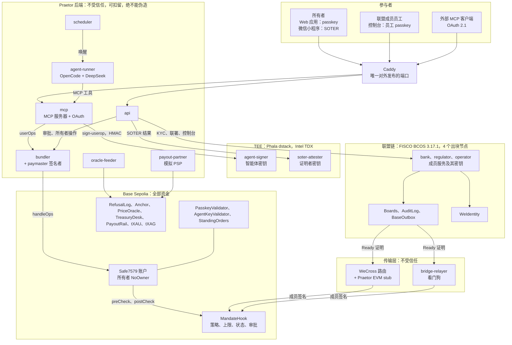
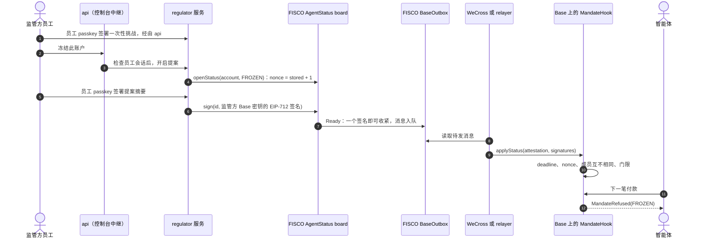
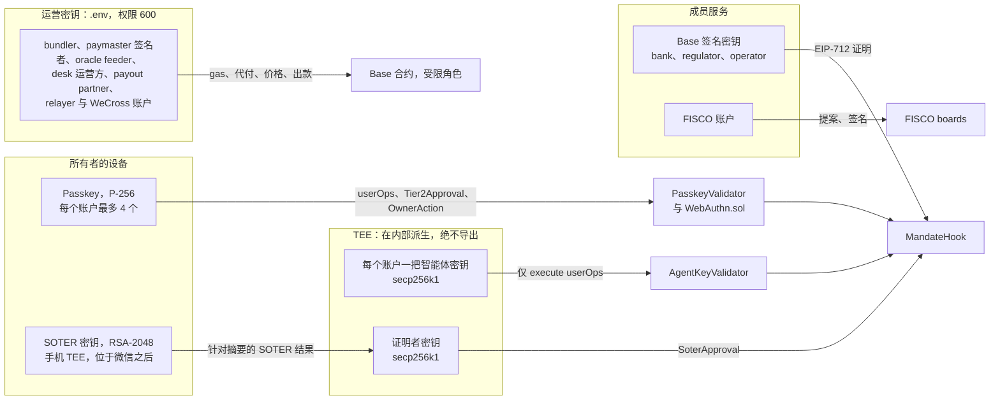
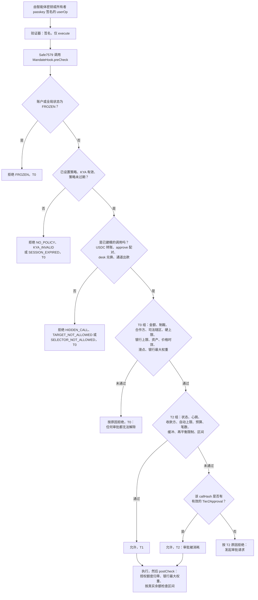
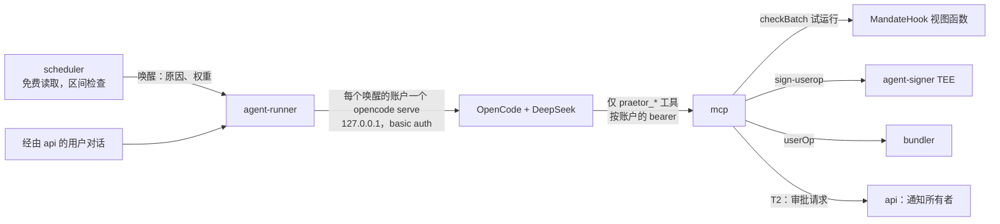
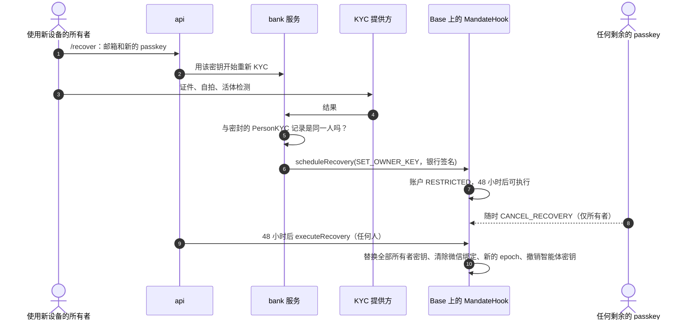

英文版：[ARCHITECTURE.md](../ARCHITECTURE.md)

# Praetor 架构

> **Self-driving money; the regulator holds the brakes.**
>
> **自动驾驶的资金，刹车握在监管者手中。**

Praetor 是一个智能体钱包（FinTechathon 2026，国际赛道，赛题 F）。AI 智能体从 **Base Sepolia** 上的 ERC-4337 智能账户出发，自主管理用户的投资组合（USDC、代币化黄金 tXAU、代币化白银 tXAG）并支付账单。三项性质同时成立：

- **自主（Autonomous）**：在授权委托范围内，智能体无需询问任何人即可再平衡和付款。
- **有界（Bounded）**：账户发出的每一笔调用都要经过链上的 **Mandate hook**，它执行用户的规则和银行的上限，默认拒绝。任何异常操作都需要所有者的 Face ID（passkey，或微信内的 SOTER）。
- **受监管（Regulated）**：由银行、监管方、运营方组成的 **FISCO BCOS** 联盟链掌握身份、获准资产、制裁名单、智能体状态以及只追加的审计日志。其决定以成员签名的形式到达 Base，由 hook 自行验证。监管方一个签名即可冻结智能体；放宽需要三分之二。

本文档是面向评委的技术文档：先给出全景图，再介绍核心算法、安全设计和部署。它描述 2026-10-18 时实际构建的代码，此时 Web 应用、小程序、智能体密钥轮换与恢复（F10）、Base Sepolia 部署以及生产 compose 均已加入；第 7 节列出仍待完成的里程碑关卡（D85）。构建与 `spec/` 不一致之处，引用 [DECISIONS.md](../DECISIONS.md) 中的条目。英文版：[ARCHITECTURE.md](../ARCHITECTURE.md)。安全证据：[SELF_ASSESSMENT.md](SELF_ASSESSMENT.md)（英文版 [security/SELF_ASSESSMENT.md](../security/SELF_ASSESSMENT.md)）。

## 1. 系统全景图



**信任边界。** 安全上受信任的部分：hook 的代码、在各自门限内的成员密钥、所有者的 passkey、银行登记的 TEE 度量值、腾讯 `verify_signature` 的应答、配合 P-256 预编译的 WebAuthn.sol。其余一切（api、mcp、大模型、scheduler、bundler、relayer、WeCross、处于偏差界限内的 oracle feeder）都不受信任：它们可以延迟或扣留，却无法伪造 hook 会接受的签名。沉默即失效安全：没有心跳，智能体便失去自主权。

| 区域 | 组件（目录） |
|---|---|
| Base Sepolia（chain id 84532） | `contracts/base`：MandateHook 及其库、PasskeyValidator、AgentKeyValidator、NoOwner、StandingOrders、PayoutRail、PriceOracle、TreasuryDesk、RefusalLog、Anchor、PraetorPaymaster、WeCrossInbox、内置（vendored）的 WeCrossProxy、tXAU 与 tXAG（自研 ERC-3643，含 IdentityRegistry 和 Compliance） |
| FISCO BCOS（chain id 20200） | `contracts/fisco`：MemberRegistry、AgentStatus、MandateRegistry、AssetRegistry、SanctionsList、JurisdictionRules、AttesterRegistry、AuditLog、BaseOutbox；WeIdentity 合约；WeCross hub 与 proxy |
| 成员服务 | `services/bank`、`services/regulator`、`services/operator`，基于 `packages/member-kit` |
| 后端 | `services/api`、`mcp`、`agent-runner`、`scheduler`、`bundler`、`oracle-feeder`、`notifier`、`bridge-relayer`、`payout-partner`、`alipayplus-mock`（同时充当微信支付模拟）、`kyc-vendor-mock`、`fake-llm`（仅测试用） |
| TEE | `services/agent-signer`、`services/soter-attester`（本地运行于 dstack 模拟器，生产环境运行于 Phala Cloud CVM） |
| 传输层 | `wecross/evm-stub`（Java 8）、`infra/wecross`、`services/bridge-relayer` |
| 前端 | `apps/web`（React、3D 手机、英文与中文、支持 Web 推送的 PWA、联盟控制台、恢复页面、临时评委沙盒）；`apps/miniprogram`（微信小程序，原生 WXML，英文与中文，SOTER 审批） |
| 共享包 | `packages/protocol`（EIP-712 类型、拒绝原因码、callHash、策略、审计链、TS 与 Solidity 双端的黄金向量）、`chain`、`userop`、`config`、`db`、`fisco-client`、`weid-client` |

## 2. 两条链与跨链桥

资金在 Base 上；权力在 FISCO 上。联盟的一项决定是 FISCO 上的一个提案，成员用各自的 Base 签名密钥签署；达到门限后排队发往 Base，由 hook 再次检查每一个签名。传输层无法修改消息，只能延迟它。演示中的冻结，端到端如下：



e2e 测试 `test/e2e/F9-governance.test.ts` 证明了这一流程（冻结在 60 秒内于 Base 生效，智能体的下一步操作被以 FROZEN 拒绝，放宽时一个签名被拒绝、两个签名被接受），`test/integration/wecross.test.ts` 证明了 WeCross 路径。

## 3. 谁持有哪把密钥



| 密钥 | 能做 | 不能做 |
|---|---|---|
| 所有者 passkey | 验证所有者的 userOps（`execute`，以及首个操作时 launchpad 的 `setupSafe`）；签署 Tier2Approval 和 OwnerAction 摘要；登录 Web 应用，仅限 PasskeyValidator 持有它期间（D47） | 没有银行就放宽任何规则（T3），包括新增另一台设备（`SET_OWNER_KEY`）；产生 ERC-1271 签名 |
| 智能体密钥（agent-signer TEE，`getKey("praetor/agent/<account>/v<n>")`；轮换即换到下一个版本，见 4.13 节） | 验证其账户的 `execute` userOps，目标不能是账户自身 | 修改规则、密钥或模块；在 hook 之外行动；为其他链或其他 entry point 签名（agent-signer 拒绝） |
| 证明者密钥（soter-attester TEE） | 在腾讯验证了针对确切摘要的 SOTER 签名之后签署 `SoterApproval` | 没有新的 SOTER 签名就审批；在任一成员将其停用后继续行动 |
| 成员 Base 签名密钥 | 签署联盟证明；银行的密钥还联署所有者操作，并在其重新 KYC 之后单独签署恢复流程的 `SET_OWNER_KEY`（4.13 节） | 超出其门限：1 个收紧，2 个放宽，上限、KYA、资产与证明者的激活仅由银行签署 |
| 成员 FISCO 密钥 | 开启并签署 FISCO 提案，追加审计条目（operator） | 在 Base 上做任何事 |
| Bundler、paymaster 签名者 | 向五个白名单合约提交 userOps 和普通交易；为已登记账户代付 gas | 伪造用户或成员签名 |
| Oracle feeder | 推送价格，每次更新最多 25 % | 交易 |
| Desk 运营方、代币 agent（银行） | 登记身份、运营 desk、冻结代币；ERC-3643 agent 角色可强制转移 tXAU 和 tXAG（已知风险 12）；发送银行的 `scheduleRecovery` 交易（权限来自其中携带的银行签名） | 转移 USDC；替他人交易 |
| Payout partner | 在 PayoutRail 上提取、结算或失败处理自己的出款 | 从钱包中划款 |

所有非 TEE 密钥都存放在 `.env`（被 git 忽略，权限 600）中，分为三套：`LOCAL_*`（anvil 分叉）、`LIVE_*`（Base Sepolia）、`SANDBOX_*`（评委沙盒）。服务先读取无前缀的名称，再读取当前密钥集前缀的名称（D1）。EIP-712 域名携带环境信息（`Praetor`、`Praetor-local`、`Praetor-sandbox`），每个环境有自己的成员密钥，因此即使分叉和线上 Base 共用 chain id 84532，签名也绝不可能跨环境重放。

## 4. 核心算法

### 4.1 MandateHook 决策流水线

`MandateHook` 是每个账户唯一的全局 ERC-7579 hook（Safe7579 恰好只支持一个）。Safe7579 在每次 `execute`、`executeFromExecutor`、`installModule` 和 `uninstallModule` 之前调用 `preCheck`，之后调用 `postCheck`。Safe 唯一的原生所有者是 `NoOwner`，其 ERC-1271 永远失败，所以 `execTransaction` 和所有者签名回退路径都是死路（I1）。两个验证器对每个 ERC-1271 请求都返回“无效”，所以无法利用 USDC 的 `permit` 和 `transferWithAuthorization` 绕过 hook 划走资金（I16）。

`preCheck` 按选择器路由：`execute`（仅单笔或批量模式，仅规范 ABI 编码）、`executeFromExecutor`（仅来自 StandingOrders）、模块调用（仅作为已批准的模块变更的内层调用，通过 transient storage 交接，D8）。其余一切都是 `HIDDEN_CALL`。执行中的每一笔调用随后都经过同一个评估器 `DecisionLib.evaluate`，它也是视图函数 `check()` 和 `checkBatch()` 的底层。它对任何输入都绝不 revert（I12）：它返回一个原因和一个层级。



代码执行检查的顺序（spec 03，移植自 BSA Sentry 的 `decide.rs`）：

| 步骤 | 付款（`USDC.transfer`）与出款（通过 Alipay+ 或微信支付的 `PayoutRail.pay`） | 再平衡（`TreasuryDesk.swap`） | 层级 |
|---|---|---|---|
| 基础检查 | FROZEN、NO_POLICY、KYA_INVALID、SESSION_EXPIRED；附带 ETH 或调用账户自身即为 HIDDEN_CALL | 同左 | T0 |
| 分类 | 精确的选择器和 calldata 长度、规范的地址填充；已知合约上的其他调用为 SELECTOR_NOT_ALLOWED，其他任何目标为 TARGET_NOT_ALLOWED | 同左 | T0 |
| T0 组 | INVALID_AMOUNT（为 0 或超过 2^128）；SANCTIONED；出款合作方非 ACTIVE（COUNTERPARTY_NOT_APPROVED）；JURISDICTION_BLOCKED；OVER_HARD_CAP 超过 min(策略硬上限, 银行单笔上限)；BUDGET_EXCEEDED 超过银行日上限或月上限 | INVALID_AMOUNT；desk 非 ACTIVE；ASSET_NOT_APPROVED（一侧为 USDC，买入代币为 ACTIVE，卖出代币非 DELISTED，两者都在区间配置中）；STALE_PRICE；SLIPPAGE（`minOut` 低于预言机价值减去 `maxSlippageBps`）；BAND_BREACH 超过银行最大权重 | T0 |
| T2 组 | RESTRICTED（状态、所有者暂停或待执行的恢复）；STALE_STATUS（心跳过期）；UNKNOWN_PAYEE（收款方或 `merchantKey` 不在策略中）；OVER_AUTO_CAP；BUDGET_EXCEEDED（用户预算）；COUNT_EXCEEDED；BUFFER_BREACH | RESTRICTED；STALE_STATUS；REBALANCE_LIMIT（`maxTradeUsd`、`maxRebalancesPerDay`）；BAND_BREACH（某资产最终落在区间外且未向目标靠近，I15）；BUFFER_BREACH | T2 |
| approve 模式 | 只有紧接在花费恰好该金额的 `swap` 或 `pay` 之前，`approve(spender, amount)` 才被允许，并继承其决定；`postCheck` 要求授权额度回到零 | 同左 | 继承 |
| 效果 | 支出计数器（日 = `timestamp / 1 days`，月 = `timestamp / 30 days`）、笔数、审批被消耗、每笔调用一个 `Decision` 事件 | 再平衡计数器、`Decision` 事件 | |

累计值在批量中的各笔调用之间延续，因此批量无法把一笔付款拆分到上限以下。由 StandingOrders 执行器执行的定期付款会应用基础检查、T0 检查和 approve 模式，但不应用 T2 组：所有者和银行已预先批准了这笔确切的订单。执行之后，`postCheck` 读取真实余额：买入的代币必须保持在银行最大权重以内；除非有人工批准了区间突破，否则每个区间都必须落在范围内或比之前更接近目标。

拒绝会留下证据。Safe7579 会把 hook 的 revert 转为 `ExecutionFailed()`，所以 bundler 仍会提交被拒绝的操作（有限流），然后调用 `RefusalLog.log`，它用 `check()` 重新计算原因，而不是相信上报者（I11）。spec 02 的 28 个原因码就是线上取值；hook 从不返回 `TIER2_REQUIRED` 或 `TIER2_INVALID`：无效的审批会使其登记操作 revert（D65）。

### 4.2 签名：EIP-712 摘要与 passkey

`packages/protocol` 只定义一次 13 个 EIP-712 类型，同时用 TypeScript 和 Solidity（`sol/PraetorTypes.sol`）实现，两端都用同一组黄金向量（`packages/protocol/vectors`）校验。域为 `{name, version "1", chainId 84532, verifyingContract = MandateHook}`。即使在 FISCO 上，chain id 也固定为 84532，因此 FISCO board 的 `digestOf` 与 hook 验证的摘要逐字节一致（非国密配置）。

- **callHash** 把一次人工审批绑定到一笔确切的调用：`keccak256(abi.encode(account, 84532, target, value, keccak256(data)))`。
- **防重放**：联盟证明对每个键使用 `nonce == stored + 1`，由 FISCO 分配（I18）；Tier2Approval 和 OwnerAction 携带随机 nonce，hook 将每个摘要标记为已使用（`usedDigest`）；有效期最多一小时；审批按账户 epoch 存储，恢复操作会使 epoch 递增。
- **Passkey**：`PasskeyValidator` 为每个账户保存最多四把 P-256 密钥，以 `credIdHash` 为键，使用 Coinbase 的 WebAuthn.sol（要求用户验证，拒绝 high-s）在地址 `0x100` 的 RIP-7212 预编译上验证 WebAuthn 断言（forge 测试回退到 FreshCryptoLib）。对 userOp 而言，挑战是 userOpHash；对审批或所有者操作而言，挑战是 EIP-712 摘要。同样的检查（`OwnerLib._ownerAuth`）在 hook 内部运行，因此所有者的同意是在链上验证的，而不是由我们的服务器验证。
- **所有者认证编码**：`OwnerAuth{kind, data}`，`kind` 为 PASSKEY（凭证哈希与 WebAuthn 数据）或 SOTER（`SoterApproval` 与证明者签名）。

### 4.3 通过证明者 TEE 的 SOTER 审批

SOTER 是微信的生物识别签名：手机的 TEE 对一段包含我们挑战值的 JSON（`resultJSON`）签名，只有腾讯能验证它（公钥不对外公开）。Praetor 把它转换为链上审批：

1. 小程序以十六进制的 EIP-712 摘要作为挑战值运行 SOTER，并连同一个新的 `wx.login` code 发送结果。
2. api 将其转发给 **soter-attester**（每个调用方独立的 HMAC，D32）。证明者用 code 换取 openid，请求腾讯的 `verify_signature`（必须返回 `is_ok`），并且除非 `resultJSON.raw` 与摘要完全相等，否则拒绝。
3. 它计算 `bindingHash = keccak256(abi.encode(keccak(appId), keccak(openid), keccak(uid), keccak(cpu_id)))`（原始标识符绝不上链），并用其 TEE 密钥签署 `SoterApproval{account, digest, bindingHash, soterCounter, expiresAt}`。
4. hook 仅在以下条件全部满足时接受：签名者是**处于激活状态**的证明者（由银行用经过验证的 quote 中的度量值登记，D33），账户和摘要匹配，绑定等于该账户已关联的绑定，有效期在一小时以内，并且计数器大于已存储的值（`soterCounterStrict`，已知风险 16）。

绑定由 `LINK_WECHAT` 设置，这是一个需要 passkey 和银行的所有者操作，并携带针对关联摘要的 SOTER 证明（流程 F2）。只有在策略启用时才接受 SOTER，且 `LINK_WECHAT` 和 `SET_OWNER_KEY` 永远不接受 SOTER。

### 4.4 联盟证明：门限与 nonce

在 FISCO 上，每种决定类型都有一个 **board** 合约（`contracts/fisco/src/Board.sol`）：成员的 FISCO 账户开启提案；board 为该键分配提案 id 和 `nonce = stored + 1`（每个键同时只能有一个开启的提案）；成员用其 Base 签名密钥签署 EIP-712 摘要；签名按签名者排序保存；达到门限时 board 发出 `Ready` 并将证明加入 `BaseOutbox` 队列。过期的提案被关闭并释放其 nonce；错过 Base 截止时间而未送达的 Ready 消息会以相同的 nonce 重新签发（D25）。成员服务只有在员工 passkey 对确切摘要的断言下才会签名，但有四个自动化、经规则检查的签名除外：operator 的心跳、银行的 KYA、银行对所有者操作的联署、银行对锚定的联署（D24、D41）。在 board 之外，银行还会在其重新 KYC 结果一致后，单独签署恢复流程的 `SET_OWNER_KEY`（4.13 节）。

在 Base 上，`ConsortiumLib`（hook 的一个库）仅在满足 `block.timestamp <= deadline`、`nonce == stored + 1`，并且签名恢复出的成员互不相同且按升序排列（无重复，无可延展签名）时才接受消息。实际构建的门限如下：

| 消息 | 收紧 | 放宽 |
|---|---|---|
| 状态（按账户，或以 account 0 表示全局） | 1 个成员，当新状态更严格时 | 2 个成员（状态不变时也一样） |
| 制裁 | 1 个列入 | 2 个移出 |
| 司法辖区（禁止稳定币出款） | 1 个禁止 | 2 个解除 |
| 资产（代币、desk、出款合作方） | 任意 1 个暂停或下架 | 银行（激活、提高最大权重、变更类型） |
| 证明者 | 任意 1 个停用 | 银行激活 |
| 按风险等级的上限、KYA | 银行 | 银行 |
| 心跳 | 任意 1 个，epoch = stored + 1，最长有效一天 | |
| 锚定（`Anchor.anchor`） | 任意 2 个成员，seq = stored + 1 | |

账户的有效状态取其自身状态与全局状态中更严格的一个。冻结也会阻止模块变更，包括移除 hook（D19）。

### 4.5 心跳失效安全

operator 服务每 `HEARTBEAT_INTERVAL_S`（本地 60 秒，生产 300 秒）开启一个 `HeartbeatAttestation`，有效期为最新 Base 区块时间之后的 `HEARTBEAT_TTL_S`（本地 180 秒，生产 900 秒），并由自己签名。如果心跳中断（联盟链宕机、传输被切断，或有人扣留消息），所有自主操作都会被以 `STALE_STATUS` 拒绝。这是一个 T2 原因：所有者仍可手动批准付款，智能体在下一次心跳时恢复自主权。因此，扣留消息永远不会扩大智能体的权力。

### 4.6 传输层：WeCross，relayer 作为看门狗

`BRIDGE=wecross` 是本地默认值（D42）。持有 WeCross 路由 FISCO 账户密钥的 bridge-relayer 调用 `BaseOutbox.requestWeCross(id)`；outbox 调用 WeCross hub；**WeCross 路由**（1.4.0，FISCO 侧使用原版 BCOS3 stub）轮询 hub，并把调用交给 **Praetor 的 EVM stub**（`wecross/evm-stub`，Java 8，签名、RLP 和 ABI 与 viem 向量逐字节核对），后者向 Base 上内置的 `WeCrossProxy` 发送交易。proxy 将名称 `inbox` 路由到 `WeCrossInbox.deliver(["Status", hex(abi.encode(attestation, signatures))])`，它调用 hook 的无需许可的 setter，返回 `["ok", nonce]` 或 `["error", reason]`，且绝不让路由的调用 revert。WeCross 只持有传输密钥；任何成员密钥都不进入其中。

relayer 是看门狗：任何 WeCross 在 `BRIDGE_WATCHDOG_S`（120 秒）内未送达的消息，它都会通过 bundler 自行提交，并在 outbox 中记录送达（先写者为准）。延迟按 FISCO 的时钟、从消息入队时刻起计算（FISCO 的 web3 RPC 以秒报告区块时间，其 EVM 的 `block.timestamp` 以毫秒计），因此卡在 WeCross hub 中的请求无论 Base 时钟如何都会被送达（`services/bridge-relayer/test/relayer.test.ts`）。在 `BRIDGE=relayer` 模式下，它直接投递。作为最后手段，任何成员都可以直接向 hook 提交证明。WeCross 的已知问题及其控制方式：[security/wecross.md](../security/wecross.md)。

### 4.7 审计链、Base 锚定与 camt.053 对账单

operator 的审计写入器把事件转换为只追加哈希链的条目：hook、RefusalLog、StandingOrders、PayoutRail、TreasuryDesk 和 Anchor 的 Base 事件，以及每一个 FISCO `Ready`（通过 outbox 的 `Enqueued`）。每个条目都是规范 JSON（RFC 8785，金额为十进制字符串，十六进制为小写），属于 18 种类型之一（DECISION、REFUSAL、APPROVAL、OWNER_ACTION、STATUS、HEARTBEAT、KYA、ASSET、SANCTIONS、JURISDICTION、CAPS、STANDING_ORDER、PAYOUT_REQUESTED、PAYOUT_SETTLED、REBALANCE、ANCHOR、KEY_ROTATION、RECOVERY），并且

```
entryHash = keccak256(canonical JSON without entryHash)
head_n    = keccak256(abi.encode(head_{n-1}, entryHash_n)),  head_0 = 0x0
```

operator 先存储条目，再把其哈希追加到 FISCO 上的 `AuditLog`（仅 operator 可写），然后将其标记为已追加，因此崩溃也绝不会重复追加（D41）。每 `ANCHOR_EVERY` 个条目（20 个）或每 `ANCHOR_INTERVAL_S`（生产环境一小时），operator 开启一次锚定：`AuditLog.openAnchor` 从日志本身读取序号、链头和区块号，因此没有人能锚定一个不在日志上的链头。operator 签名；银行只有在用 operator 的 JSON 重算整条链并到达该链头之后才会联署；两个签名使其成为 Ready，并落入 Base 上的 `Anchor`。仍处于开启状态的锚定（其联署因重启而丢失）会被继续完成，而不是重新开启一个会被 board 拒绝的锚定。

验证（`/api/audit/verify`，Web 应用的 Audit 页面）使用三个相互独立的来源：仅凭 JSON 重算每一个哈希；将结果与 FISCO 的链头比对（并对 `headAt` 二分查找，即使被篡改条目存储的哈希已被改写，也能指出第一个被篡改的条目）；检查最新的 Base 锚定是重算链头之一。**camt.053** 银行对账单（ISO 20022 `camt.053.001.02`）由账户的 USDC 转账和出款生成，并在返回前用 xmllint-wasm 按官方 XSD 校验；无效的文档绝不会被返回。

### 4.8 智能体运行时与 MCP 服务器



- **唤醒。** scheduler 不持有任何密钥。每 `PRICE_CHECK_INTERVAL_S`（以及 DEMO 价格事件发生时立即）它读取每个账户的权重，当某资产超出其区间 10 bps 以上且当天仍有再平衡次数时唤醒智能体，在冷却期内每个账户的每种突破最多唤醒一次（D36）。监控不产生费用；大模型只在唤醒或对话时运行。
- **托管。** Praetor 为每个用户托管智能体：agent-runner 为每个唤醒的账户启动一个 `opencode serve`（最多 `AGENT_MAX_ACTIVE` = 8 个，淘汰最久未使用的空闲实例，空闲 30 分钟后停止）。模型为 `opencode/deepseek-v4.1-flash-free`（来自 `AGENT_MODEL`）。
- **工具锁定**（D15）。OpenCode 的配置为 `permission: {"*": "ask", "praetor_*": "allow"}`，runner 在每一轮中拒绝所有权限请求，因此内置工具（shell、文件、网页）永远不会运行。按账户的 MCP bearer 只通过环境变量替换到达 OpenCode，绝不写入文件。agent-runner 位于独立的 `agent` 网络上。
- **MCP 服务器。** 十个工具：`get_portfolio`、`get_mandate`、`get_status`、`get_activity`、`explain`、`pay`、`rebalance`、`get_approval`、`propose_standing_order`、`trigger_standing_order`。**没有任何工具接受账户参数**：账户来自 bearer。`pay` 和 `rebalance` 先用 `checkBatch` 试运行，然后总是提交，因此拒绝会作为证据记录在链上；T2 结果会为所有者发起审批请求。没有任何工具读取 KYC 数据（I9）。
- **接入任意智能体。** 外部 MCP 客户端（例如 claude.ai）通过 OAuth 2.1 接入，支持动态客户端注册和 PKCE S256（代码移植自 BSA Sentry）；用户以其 Praetor 会话表示同意。它们的操作仍然经过 TEE 中的智能体密钥和 hook。
- **签名。** agent-signer 只为 mcp 签名，只签链 84532、EntryPoint v0.7 上的 `execute` userOps，绝不以账户自身为目标，每个账户每小时最多 120 次；它自行计算 userOpHash。mcp 给出 Base 上持有的该账户智能体密钥（`kyaOf`），agent-signer 在最多 16 个版本中找到对应的密钥版本，因此 mcp 从不知道版本号，轮换也无需它做任何改动（D47）。
- **审批之后。** 所有者批准一笔 T2 调用后，api 请 mcp 重新提交它；mcp 只为在 hook 上存在有效且未被消耗的审批（`approvalOf`）的单笔调用签名，其他一律拒绝（D72）。

### 4.9 定期付款与出款通道

固定的定期付款（房租、订阅）是**定期付款指令（standing order）**，存储在钱包自己的 `StandingOrders` 执行器中：收款方、金额、周期、下次到期日、通道和一个商户哈希。只有所有者 + 银行可以创建（`ADD_STANDING_ORDER`，T3）；所有者可单独取消。任何人都可以触发到期的指令；它恰好支付该金额，每个周期一次，错过的周期被跳过；hook 仍会检查冻结、制裁、司法辖区、合作方状态和银行上限。之所以上链，是因为必须由钱包本身执行授权：若保存在数据库中，被攻破的后端就能修改金额或收款方。智能体只能提议一条指令（一个所有者请求，D40）。

通道：`USDC_DIRECT`（普通转账），或通过 `PayoutRail` 走 Alipay+ / 微信支付，后者是一个托管合约：账户用 `approve` + `pay(partner, amount, rail, merchantRef, paymentRef)` 转入 USDC，只有指定的合作方能提取、结算或失败处理（失败时退款给账户）。出款合作方（模拟 PSP，已标注）运行官方的 `ant-intl-alipayplus-mcp` 客户端，对接我们的 Alipay+ 模拟网关（RSA 签名请求，网络内部的 HTTPS）或微信支付模拟。Base 上没有个人数据：商户为 `merchantRef = keccak256(merchantId)`；名称和标签保留在链下（I19）。

### 4.10 账户创建、bundler 与 paymaster

账户是通过 launchpad 创建的 Safe7579（地址见 spec 00）：所有者 `[NoOwner]`，门限 1，验证器 `PasskeyValidator(credIdHash, x, y)` 和 `AgentKeyValidator(empty)`。首个 userOp 由 passkey 验证，执行初始化批量 `[setRegistry(0, [], 0), installModule(2, StandingOrders), installModule(4, MandateHook)]`（执行器先于 hook，D9）。验证器由 nonce key 选择（其高 20 字节为验证器地址）。

**bundler** 是我们自己的（先 `POST /userop/prepare`，再 `/userop/send`，D22）。它模拟每一个操作，绝不提交验证失败的操作（失败的首个操作会使地址报废，Q20）。`PraetorPaymaster` 只为已登记的账户或 Praetor 自己的 launchpad 初始化代付，因此用户从不持有 ETH（D20、D21）。被拒绝的操作会被提交以留下链上证据，每个账户每天最多 20 次。普通交易（联盟 setter、锚定、定期付款、拒绝日志）只发往五个白名单合约。

### 4.11 身份：WeIdentity、KYC 与 KYA

- 银行处的 **KYC**：演示 KYC 提供方（已标注的模拟：证件、自拍、活体检测、制裁名单姓名筛查；kycLevel 2），或欧盟数字身份钱包（OpenID4VP，只披露出生日期和国家；kycLevel 1，D30）。个人数据以 AES-256-GCM 加密存放在银行数据库中，绝不离开银行（I9）。
- 同一条 FISCO 链上的 **WeIdentity**：银行是权威发行方（`KYC_PROVIDER`）；它向用户的 WeID 签发 `PersonKYC` 凭证，以及一份 `AgentMandate`，由用户用账户上登记的 passkey 批准、银行联署。验证是失败即关闭的：签名、由固定发行方出具的存证、无错误地读取撤销状态（D28）。WeIdentity 的 REST 服务是托管式且无认证的，因此它位于独立的网络上（D29）。
- **智能体身份**：智能体的 WeID 由智能体公钥创建，包含服务 `AgentWallet = eip155:84532:<account>` 和 `MCP = <public URL>/mcp`，在 TEE 内签名（D32）。
- **KYA**（了解你的智能体）：银行验证 agent-signer 的 quote（密钥绑定到银行 nonce，度量值在白名单中），然后只根据自己的记录构建 `KYAAttestation`：智能体密钥、kycLevel、风险等级、司法辖区、凭证哈希、智能体度量值（D37）。只有它到达 Base 之后，所有者才能把该密钥设为智能体密钥（`SET_AGENT_KEY`，所有者 + 银行）。

### 4.12 价格与资金台

`PriceOracle` 保存 tXAU 和 tXAG 的 8 位小数美元价格（USDC 固定为 1）。设置了 `PYTH_API_KEY` 时，oracle-feeder 推送 Pyth Hermes 价格，否则推送标记为 `DEMO` 的预置价格（D13）；每次更新最多变动 25 %，hook 拒绝使用早于 `maxPriceAge`（4 天，贵金属周末不交易）的价格进行交易。演示冲击（`pnpm shock --asset XAU --pct 20`）是一个 DEMO 价格，feeder 会保持它 `DEMO_HOLD_S`。`TreasuryDesk` 以预言机价格加减 30 bps 点差兑换 USDC 和贵金属，卖出时铸造、买回时销毁。tXAU 和 tXAG 是我们自研的 ERC-3643 代币：只能在允许国家中已验证的身份之间转账。

### 4.13 智能体密钥轮换、设备与所有者恢复（F10）

链始终是密钥的唯一可信来源；api 只负责准备所有者和银行要签署的内容（D47）。

- **停止我的智能体。** `REVOKE_AGENT_KEY` 是仅需所有者的操作（T3-）：密钥立即失效。随后 api 请银行撤销 AgentKeyValidator 已不再持有的每一把智能体密钥的 AgentMandate 存证；银行在撤销前自行读取 Base。
- **轮换。** 新的智能体密钥是 agent-signer 的下一个密钥版本（`praetor/agent/<account>/v<n+1>`）。`POST /api/agent/rotate` 找到地址与 Base 上持有者一致的版本（`kyaOf`，最多 16 个版本），并为下一个版本走一遍开户路径：由银行检查 quote、智能体 DID、用 passkey 签署的 AgentMandate、由银行在 FISCO 上链接到前任的 KYA（`MandateRegistry.linkSuccessor`），最后是 `SET_AGENT_KEY`（所有者与银行）。旧密钥失效，其授权按上述方式撤销。
- **设备。** 设置页登记另一个 passkey（每个账户最多四个），并通过 `SET_OWNER_KEY` 将其加到 Base 上，由当前的某个 passkey 签名、银行联署。登录只接受 PasskeyValidator 持有的 passkey，因此新设备在 Base 持有它之后才能登录；所有者操作、审批或授权以断言 id 所指明的凭证签署。
- **恢复**（丢失全部 passkey 时）：用户打开 `/recover`，输入邮箱并创建新的 passkey；银行向 KYC 提供方自行重新进行 KYC，只有结果与密封的 PersonKYC 记录（姓名、出生日期、国籍、证件号码）一致时，银行才单独签署 `SET_OWNER_KEY`，并从其 desk 账户发送 `scheduleRecovery`。账户在 48 小时内处于 RESTRICTED，任何剩余的 passkey 都可单独取消（`CANCEL_RECOVERY`），48 小时后任何人都可执行（由 api 经 bundler 发送）。恢复需要由 KYC 提供方签发的 PersonKYC（不适用于 EUDI 路径）。恢复状态来自 hook 的 Recovery 事件；设置页显示待执行的恢复，notifier 把每个 `RecoveryScheduled` 推送到所有者的设备（D81），银行自己的通知发往其日志接收端（D13）。邮箱解析为其第一个账户；新的 passkey 只在银行开始重新 KYC 之后才保存，每个用户每小时至多五个，恢复选项不会列出账户的任何 passkey（D80）。



执行之后旧审批作废（epoch 已改变），所有者需要安装新的智能体密钥。该流程由 `test/e2e/F10-rotation-recovery.test.ts` 覆盖；由于它会把分叉链的时钟向前拨 48 小时，执行部分由 `test/warp/F10-recovery-execute.test.ts` 覆盖，`make e2e` 最后运行它；两者均已在全新分叉上通过 M15 关卡。其风险见[安全自评](SELF_ASSESSMENT.md)的已知风险 31。

### 4.14 Web 应用与联盟控制台

`apps/web`（React 与 Vite，英文与中文，可安装的 PWA）是所有者的主界面：`/` 带 3D 手机的落地页，`/start` 开户，`/home` 投资组合圆环与决策，`/approve/:id` T2 审批，`/mandate`，`/payments`（定期付款、带有供智能体识别的名称的收款方），`/agent`（与智能体对话并显示每轮调用的工具，停止或轮换智能体密钥），`/audit`（验证、camt.053），`/settings`（设备、待执行的恢复、微信绑定与解绑、Web 推送），`/recover`、`/sandbox` 和 `/console`。

- **所见即所签**（D46）。在 passkey 签名之前，页面根据请求的原像重新计算 Tier2Approval 摘要；对每个所有者操作，核对它所请求的类型、账户、`payloadHash` 与载荷是否一致以及 EIP-712 摘要；对策略、智能体密钥、新 passkey、撤销和取消恢复，它根据页面所显示的内容重建载荷（`apps/web/src/lib/ownerAction.ts`）。撒谎的 api 得不到任何签名。
- **控制台。** 每个成员（银行、监管方、运营方）一个面板并排显示；每个面板用各自成员服务的员工 passkey 登录，并以该已登记凭证进行断言。从控制台开启的提案会出现在每个成员的面板中，附带追踪器，显示谁已签名以及还需要多少签名：监管方单独即可冻结，放宽需要第二个成员。api 只做中继；成员服务根据它自己从 FISCO 读取的摘要验证员工断言。账户列表需要员工会话（D70）。
- **浏览器防护**（D71）。Caddy 发送仅允许本站脚本、禁止嵌入的 CSP，以及 HSTS、nosniff 和 no-referrer；api 拒绝来自其他 Origin 的写请求，并对公开的登录、开户和恢复接口按客户端限流。
- **测试。** `make test` 中的单元测试（`apps/web/src/lib/web.test.ts`、`apps/web/src/pages/Settings.test.tsx`）；使用虚拟认证器的 Playwright 旅程 F1 至 F10，在 1440 和 390 px 下截图并进行 axe 检查（`apps/web/e2e`，`make e2e-web`），已通过 M13 关卡（连同沙盒用例 15/15，34 张截图位于 `docs/screens/web`，每张均经 axe 检查）。

### 4.15 微信小程序

`apps/miniprogram` 是所有者在微信中的日常界面：投资组合、状态、决策、智能体对话，以及通过 SOTER 用 Face ID 或指纹完成的 T2 审批（原生 WXML、WXSS 和 JS，英文与中文）。

- **登录**（D50）。`wx.login` 给出一个 code；`POST /mp/session` 让 api 自行调用 code2Session，并只保留 `keccak256(openid)`。bearer 令牌有效期 2 小时，绝不等同于 Web 会话，并且只有在 LINK_WECHAT 之后记录的绑定仍与 Base 上的 `bindingOf(account)` 一致时才指向该账户，每次登录和每次请求都会检查（D81），因此解绑或恢复（会清除 Base 上的绑定）都会立即结束其会话。
- **路由**（D51、D53）。`/mp` 为已绑定的用户提供所有者的读取接口、智能体对话、拒绝、SOTER 审批和 F2 绑定，不提供任何所有者操作：解绑、新增定期付款和修改策略会复制 Web 应用的链接，由 passkey 在那里签名。任何响应都不包含所有者的邮箱或 KYC 数据。
- **手机端的检查**（D52、D54）。在 SOTER 签署审批之前，手机解码每笔调用，重新计算 call hash 和 Tier2Approval 摘要，并签署它自己计算的摘要；对于绑定，它要求操作为 LINK_WECHAT 且 `payloadHash = keccak256(abi.encode(linkNonce))`。摘要代码是由 `src/protocol.mjs` 生成的 `lib/protocol.js`，并用黄金向量校验。
- **状态。** 逻辑测试在 `make test` 中（替代 DevTools 构建）；在手机上，它以调试模式运行在微信测试账号下（[MANUAL.md](../MANUAL.md) 第 5 节，[TESTER.md](../TESTER.md)）。

### 4.16 通知与 Web 推送

notifier 把每条消息分发到账户的每个渠道，并保留一个发件箱：微信公众号渠道（在公众号测试账号可用之前是一个日志接收端，BLOCKERS B2）和 Web 推送。Web 应用在设置页中，用 api 公开配置里的 VAPID 公钥为其 service worker 订阅推送；api 保存订阅（`POST /api/push/subscribe`，只接受浏览器的推送服务，每个账户至多十个，D82），notifier 通过内部路由读取订阅，为每个浏览器单独加密消息（RFC 8291），并用 Praetor 的 VAPID 密钥为请求签名（RFC 8292）。service worker 显示通知，并且只在链接属于本应用页面时打开它（D82）。某个推送服务不可用时，绝不会阻塞其他渠道。

### 4.17 临时评委沙盒

spec 00 中独立的沙盒部署（域名 `Praetor-sandbox`，SANDBOX 密钥集）尚未构建；`/sandbox` 是它在主部署上的临时替代（D48、D73）。一次点击即可用浏览器自己的 passkey 创建一个一次性账户，通过演示 KYC，安装智能体和默认授权委托，并从水龙头充值：`POST /api/sandbox/faucet` 为每个账户铸造一次 5,000 演示 USDC，每个客户端每小时最多 `SANDBOX_RATE_LIMIT_PER_HOUR` 次，且只在分叉链上进行。场景按钮运行真实流程并显示其交易：向一家新咖啡馆支付 300 USDC（真实模型，用 passkey 批准）、指向演示制裁地址的提示注入、一笔房租定期付款、审计验证。冻结按钮链接到控制台：任何成员密钥都不会为某个按钮签名。

## 5. 安全设计

完整的分析以及每项结论背后的测试见 [SELF_ASSESSMENT.md](SELF_ASSESSMENT.md)（英文版 [security/SELF_ASSESSMENT.md](../security/SELF_ASSESSMENT.md)）。简而言之：

- **单一关卡。** 每一次执行都经过 hook，无论谁签名；Safe 所有者无法执行；hook 之外不存在任何签名路径（I1、I16、I17，由真实 Safe7579 上的分叉测试证明）。
- **默认拒绝，银行上限优先。** 只建模四种调用形态；有效限额始终取用户策略与银行上限中更严格者，任何审批都无法解除 T0 原因（I2、I8，模糊测试与不变量测试）。
- **人在链上审批。** 审批绑定到一笔确切的调用，一次性使用，一小时内过期，由 WebAuthn.sol 或经证明的 SOTER 审批验证（I5、I6）。
- **所见即所签。** Web 应用和小程序根据其所显示的内容重新计算它们要签署的每一个摘要，因此被攻陷的 api 无法让它们为别的内容签名（D46、D52）。
- **越严格所需签名越少。** 一个成员即可冻结；两个才能放宽；由 FISCO 分配的 nonce 无法被跳跃（I3、I18）。沉默即失效安全（I4）。
- **证据由构造产生。** 拒绝原因在链上计算（I11）；每个决定都进入锚定在 Base 上的哈希链。
- **数据最小化。** KYC 数据留在银行；Base 上只有地址、金额和哈希，以及假名化的 KYA 属性（I9、I19、D69）。

分级授权，每级一句话：**T0** 永不（hook 拒绝）；**T1** 智能体单独完成；**T2** 所有者通过 passkey 或 SOTER；**T3** 所有者和银行（让规则更严格时所有者可单独完成）；**T4** 联盟链。

## 6. 部署

**本地即小型生产环境**（spec 11）：一个 Docker Compose 文件（`infra/compose.yml`），profile 包括 `core`、`chain`、`wecross`、`agent`、`tee-sim`、`mocks`、`dev`；所有拉取的镜像都以 digest 固定；每个长期运行的服务都有健康检查。只有 Caddy 对外发布端口（80 和 443；anvil 另外在回环地址 18545 上监听，供 Foundry 使用）。三个网络隔离了不应互通的部分：`praetor`（10.88.0.0/16）、`identity`（WeIdentity 只与银行、MySQL 和一个 FISCO 节点相连，D29）以及 `agent`（agent-runner 与 mcp、scheduler、api 和仅测试用的假大模型，D35）。MySQL 为每个服务提供一个数据库和一个用户。Base 以带 P-256 预编译的 Base Sepolia anvil 分叉运行（`--network optimism`），它会重试公共 RPC，并每 20 秒把状态转储到一个卷中（D45）；FISCO 以四个出块节点运行，使用我们基于 sha256 固定的 3.17.1 发行版自建的镜像；TEE 运行在 dstack 模拟器上。

**实链模式**（M16，D74、D75）。`make up LIVE=1` 会加入 `infra/live.env`：整个栈使用 `LIVE_` 密钥在 Base Sepolia 上运行，不启动 anvil，使用 `infra/deployments/base-sepolia.json`（MandateHook `0x839E104c8C2df983213a89CAcB58440Da4AdC2A9`，在区块 48253270 以域名 `Praetor` 部署），`DEMO_SCALE=100`，心跳与价格检查采用生产间隔。FISCO 仍是本地链，由 `LOCAL` 密钥集治理（`FISCO_KEYSET=LOCAL`），其上另有一个绑定到线上 hook 的联盟部署（`infra/deployments/fisco-live.json`）；Base 信任的每一把密钥都来自 `LIVE_` 密钥集。实链预算很小：`scripts/deploy/fund-live.ts` 把部署者的测试网 ETH 分发给需要支付 gas 的账户（不加 `--send` 时只是试运行），一次带 0.004 ETH paymaster 押金的部署共花费约 0.0045 ETH。`scripts/evidence/live-run.ts` 用真实模型运行证据流程，`scripts/evidence/collect.ts` 根据链上数据写入 [EVIDENCE.md](../EVIDENCE.md)；截至本次提交，证据尚未采集。

**生产环境**（Phase C，与人工一起完成）：一台服务器运行整个栈，另加两台 Phala Cloud CVM（Intel TDX，dstack）运行 agent-signer 和 soter-attester，配置 `ATTESTATION_MODE=phala`，compose hash 由银行登记，机密以加密环境变量传入，并使用线上 Base Sepolia 部署。`infra/compose.prod.yml` 在同一个基础文件之上，为每个长期运行的服务加上重启策略、为所有服务加上日志轮转，不启动脚本化模型（放入 `test` profile），让 Caddy 获取真实证书（`CADDY_TLS` 为 ACME 账户邮箱，而不是 `internal`），并停用明文 HTTP 的隧道站点（其主机名永远无法解析）。`make rehearsal` 用它启动整个栈（`PRAETOR_ENV=rehearsal`），运行流程的冒烟子集，然后运行 `scripts/deploy/prod-refusals.sh`，检查每个服务在 `PRAETOR_ENV=prod` 下都拒绝其仅测试设置（I13）。在域名可用之前，手机通过 `make tunnel` 访问笔记本上的栈：一个通过明文 HTTP 连接 Caddy 的 cloudflared 快速隧道，它把 URL 写入 `.run/tunnel-url`，并把小程序的 develop 环境指向它（[TESTER.md](../TESTER.md)）。步骤：[DEPLOY.md](DEPLOY.md)（英文版 [DEPLOY.md](../DEPLOY.md)）；TEE 检查清单：[security/tee-checklist.md](../security/tee-checklist.md)。

## 7. 2026-10-18 时的构建状态

“已构建”指代码及其单元测试已在 `make test` 中；只有 `docs/PROGRESS.md` 勾选了某个里程碑关卡，它才算通过（D85）。

| 范围 | 状态 |
|---|---|
| Base 与 FISCO 合约、协议、bundler、成员服务、身份、模拟器上的 TEE、带 MCP 的智能体、api、定期付款与出款、审计与 camt.053 | 已构建并测试；M1 至 M11 关卡已通过 |
| WeCross 传输 | 已构建并测试（M12，关卡已通过：在全新分叉上以 `BRIDGE=wecross` 运行，集成测试 16/16 个文件、e2e 41/41，F9 的冻结经由 WeCross 送达） |
| 带联盟控制台、收款方、设备、恢复页面、Web 推送、临时沙盒的 Web 应用 | 已构建并测试（M13，关卡已通过：Playwright 旅程 F1 至 F10 和沙盒用例 15/15，34 张 1440 与 390 px 截图，每张均经 axe 检查） |
| 微信小程序 | 已构建（M14，关卡已通过：逻辑测试，MANUAL 步骤已编写）；手机上的步骤在 Phase C 中执行 |
| 智能体密钥轮换、设备与所有者恢复（F10） | 已构建并测试（M15）；关卡已在全新分叉上通过：`test/e2e/F10-rotation-recovery.test.ts` 3/3（停止、轮换、恢复的安排与取消）以及 48 小时的 `test/warp/F10-recovery-execute.test.ts`（`executeRecovery` 之后只有新 passkey 能登录，智能体密钥被撤销） |
| 国密（SM）配置冒烟测试 | 已运行并记录在 [SMOKE.md](../SMOKE.md) 中：11 项自检和 37 项链上检查通过；WeIdentity 场景 43 项中 39 项通过（BLOCKERS B3） |
| Base Sepolia 部署与实链模式 | 合约已部署到 Base Sepolia，联盟已部署到 FISCO（D74、D75）；实链证据尚未采集（M16 关卡尚待完成） |
| 红队测试套件 | 本次提交时尚未构建（`make redteam` 只是占位） |
| 生产 compose、演练目标、生产拒绝检查、手机隧道 | 已构建（M18）；演练关卡尚待完成；云端部署属于 Phase C |

WeBASE 浏览器在 Phase 0（V9）中得到验证，但不属于该栈（削减清单，D4）。
